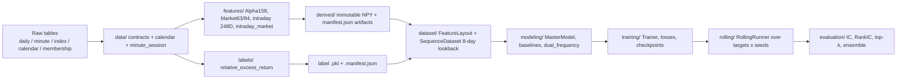

# Repository Guidelines

## Project Overview

Research code for **cross-sectional equity return forecasting**, with two market profiles: **China A-shares** (the original, published results) and **US equities** (Phase 1: daily Stage 1). It uses a MASTER-style market-guided Transformer, plus GRU, vanilla Transformer, and LightGBM baselines. Raw daily/minute market tables become immutable feature and label artifacts, and JSON experiment configs then drive walk-forward rolling training, prediction, multi-seed ensembling, and evaluation.

- Package: `market_guided_stock_alpha` (in `src/`). Distribution name: `end-to-end-stock-transformer`.
- Target: the benchmark-relative 5-day excess return `y = (adj_open[t+6]/adj_open[t+1]) / (bench_open[t+6]/bench_open[t+1]) - 1`. Benchmark is CSI500 `000905.SH` (China) or `SPY.US` (US).
- **The market profile is selected by the config's `universe`** (`rolling/configuration.py` `_MARKET_PROFILES`):
  - `dynamic_all_a_shares` → China label contract + layouts `stage1_market63` etc.
  - `dynamic_us_common_stocks` → SPY label contract + layouts `us_stage1_market63` / `us_stage1_market84`.
  - A layout from the other profile is rejected. China behavior must stay byte-identical when you change shared code.
- Raw market data is **not** in the repo. `data/`, `runs/`, and checkpoints are gitignored.

## Architecture & Data Flow



Key points:
- **Two-phase design.** Phase 1 is the offline builders in `scripts/build_*.py`, which write artifacts once. Phase 2 is `scripts/run_rolling.py`, which reads those artifacts lazily through mmap. Training never recomputes features.
- **The config is the single input** to phase 2. `rolling/configuration.py` handles it: `validate_experiment_config` → `load_experiment_config` → `run_from_json_config`. `_model_factory` and `_training_factory` build a fresh model and `TrainingConfig` for each seed. LightGBM dispatches to `RollingRunner.run_lightgbm` and requires `"initialization": "cold"`.
- **FeatureLayout** (`dataset/layout.py`) decides which families are concatenated:
  - `stage1()` = alpha158 + market63
  - `stage2(market_family)` = alpha158 + intraday_price_volume (158+248 = 406 stock dims) + market63 or market84
  - `dual_frequency()` adds `intraday_market`
  - Config names: `stage1_market63`, `stage2_market63`, `stage2_market84`, `dual_frequency_exploratory`
- **One sample = one prediction date's whole cross-section.** Stock features are `[N, T=8, F_stock]`; market features are `[T, F_market]` and are broadcast *inside* `model.forward`, not in the loader. Labels are z-scored per date, and raw labels are kept for IC. `label_mask` / `stock_mask` are bool, with True meaning valid.
- **Leakage guards:**
  - Label purge offset `PURGE_DEPENDENCY_OFFSET_TRADING_DAYS = 6`, so validation starts 6 trading days after training ends.
  - Preprocessing is fit on training dates only, and `CheckpointContract` enforces this.
  - All t+k mapping goes through `TradingCalendar`, never row shifts.
- **Warm start** loads the previous target's `best.pt` weights after checking model type/config, layout, and `feature_order_sha256`. It deliberately resets the optimizer and RNG.

## Key Directories

| Path | Purpose |
|---|---|
| `src/market_guided_stock_alpha/data/` | Input schema validation (`contracts.py`), `calendar.py`, `io.py` (csv/parquet/pickle, wide-minute pickles), `minute_session.py` (strict 120+120 bars) |
| `.../features/` | `alpha158.py` (fixed 158 spec, locked to a Qlib blob SHA), `market63.py`/`market84.py`/`market_state.py`, `intraday_market.py`, `rolling_ops.py` |
| `.../features/intraday/` | Frozen F001–F248 registry (`registry_base.py` F001–F148, `registry.py` up to F248) and per-category compute modules |
| `.../labels/` | Label builder, `DerivedLabelReader`, label normalization |
| `.../derived/` | Artifact `specs.py`, `builders.py`, `artifact.py` (write/read + SHA-256 checks), `readers.py` |
| `.../dataset/` | `layout.py`, `dataset.py` (`SequenceDataset`), `alignment.py`, `splits.py`, `normalization.py` |
| `.../modeling/` | `master.py`, `baselines.py`, `lightgbm.py`, `ablation.py`, `transport.py` (`DateBatch`, `forward_date_batch`), `experimental/dual_frequency.py` |
| `.../training/` | `config.py`, `losses.py` (`LOSS_NAMES`, `build_loss`), `trainer.py`, `checkpoint.py`, `seed.py`, `preprocessing.py` |
| `.../rolling/` | `configuration.py` (JSON → run, market profiles, R2 materialize/publish), `runner.py`, `targets.py` (semiannual/quarterly/monthly windows), `prediction.py`, `artifacts.py` |
| `.../evaluation/` | `metrics.py`, `multi_seed.py`, `overall.py` |
| `.../features/us_market.py` | `us_market63` (SPY/IJH/IJR) and `us_market84` (+IWM) market-state families reusing `market_state.py` formulas |
| `.../us_data/` | Alpaca (`alpaca-py`) + OpenFIGI fetch and US universe assembly into canonical tables (`scripts/fetch_us_daily.py`) |
| `.../storage.py` | `r2://bucket/key` locations: `materialize` (download into a temp cache), `publish` (upload; refuses existing locations unless `overwrite=True`) |
| `configs/us/stage1/` | US experiment configs; all data/output paths are `r2://stock-transformer-data/us/v1/...` |
| `configs/{stage1,stage2,secondary,exploratory}/` | Experiment JSONs. The folder must match `research_position` |
| `scripts/` | CLI entry points (thin `argparse` wrappers around package functions) |
| `docs/` | Data contract, intraday factor catalog, experiments, reproducibility, portfolio notes |
| `results/` | Published result CSVs and `metric_definitions.json`. Static, not regenerated by tests |

## Development Commands

```bash
uv sync                              # locked deps + dev group (pytest); add --extra lightgbm --extra parquet as needed
uv run pytest -q                      # full suite (~20 s)
uv run pytest tests/test_dataset.py -q
uv run pytest "tests/test_alpha158.py::Alpha158CanonicalTest::test_feature_count_names_and_order_are_fixed"

# Pipeline (paths illustrative; output dirs must not already exist). Scripts run via `uv run scripts/<name>.py` (or ./scripts/<name>.py: uv shebang)
uv run scripts/build_relative_excess_label.py --stock-daily data/daily_stock.parquet \
  --benchmark-daily data/daily_index.parquet --calendar data/calendar.csv \
  --output data/derived/relative_excess_return_5d.pkl
uv run scripts/build_daily_features.py alpha158 --input data/daily_stock.parquet --output data/derived/alpha158
uv run scripts/build_daily_features.py market63 --input data/daily_index.parquet --output data/derived/market63
uv run scripts/build_intraday_features.py intraday_price_volume --input data/minute_stock.parquet \
  --output data/derived/intraday_price_volume      # or --wide-open/--wide-high/.../--wide-amt pickles
uv run scripts/run_rolling.py configs/stage1/master_d512_market63.json --device cuda --resume

# US (secrets in git-ignored .env; `export UV_ENV_FILE=.env` makes --env-file the default)
uv sync --extra us
uv run --env-file .env scripts/fetch_us_daily.py --output r2://stock-transformer-data/us/v1/raw
```

There is no linter or formatter configured. Match the surrounding style.

**uv is the only tool.** Never use `pip`, bare `python`, or bare `pytest`.
- Add deps with `uv add <pkg>` (runtime), `uv add --optional <extra> <pkg>` (extras: `lightgbm`, `parquet`, `us`), or `uv add --dev <pkg>` (tooling). These update `pyproject.toml` and `uv.lock` together; never hand-edit the lock.
- Run everything with `uv run ...`. `pytest` comes from the `dev` dependency group, which `uv sync` installs by default.
- Scripts have a `#!/usr/bin/env -S uv run` shebang and are executable.

## Code Conventions & Common Patterns

- **Python 3.8-compatible syntax** is the house style, even though the project now requires `>=3.14`. `tests/test_configs_and_packaging.py` parses every source file with `ast.parse(..., feature_version=(3, 8))`. Do not use `match`, `X | Y` types, or builtin generics like `list[int]`. Use `typing.Dict/Tuple/Optional` and `"{}".format(...)` like the existing code.
- **Frozen dataclasses with `__post_init__` validation**, e.g. `TrainingConfig`, `LossConfig`, `MasterConfig`, `FeatureLayout`, `RollingRunConfig`. Checks are strict (`type(x) is int`, finite/range checks). Add new knobs as validated dataclass fields, never loose dicts.
- **Fail fast with precise messages.** Use the domain exceptions: `SchemaError` / `DataQualityError` (ValueError subclasses in `data/`), `Alpha158SpecError` / `Alpha158DataError`, and alignment errors in `dataset/alignment.py`. Tests assert on message text with `assertRaisesRegex`, so changing wording breaks tests.
- **No silent repair.** Missing minute bars stay NaN with no interpolation. Days with less than 90% bar coverage are ineligible (all features NaN). Security codes must be `NNNNNN.SH|SZ|BJ`, and exchanges are never guessed.
- **Immutable, verifiable artifacts.** Builders refuse an existing output dir. Writes are atomic (temp file + `os.replace`, via `atomic_write_json` / `atomic_write_pickle`). Manifests carry SHA-256 hashes and provenance, and read arrays are `writeable=False` mmaps.
- **Frozen orderings.** Feature name order is hashed (`feature_order_sha256`) into checkpoints. Never reorder Alpha158 names, market blocks, or the F001–F248 registry. Append-only changes still require doc and test updates.
- **Registry and factory dispatch:**
  - New loss: add to `LOSS_NAMES` and `build_loss` (`training/losses.py`).
  - New model: expose `input_kind` (`"stock_and_market"`, `"stock"`, `"dual_frequency"`) and `config_dict()`, provide a `from_layout` classmethod, and wire it into `_model_factory`.
  - New feature family: add it to `feature_names(...)`, `derived/specs.py` / `builders.py`, and the script `BUILDERS` dict.
- **Determinism.** `seed_everything(seed, deterministic)` (`training/seed.py`) seeds random, numpy, and torch and enables `torch.use_deterministic_algorithms(..., warn_only=True)`. Each seed in `seeds` is an independent run. The ensemble is an equal-weight mean of raw scores (`raw_equal_weight_ensemble`).
- **Device (CPU / CUDA / MPS).**
  - `resolve_device(None)` auto-picks cuda → mps → cpu. `--device cpu|cuda|mps` forces one.
  - Every CUDA code path must also work on MPS. `torch.manual_seed` already seeds MPS, and checkpoints save/restore `mps_rng_state` next to `cuda_rng_state`.
  - **MPS has no float64.** Never create float64 tensors on the training device. On MPS, `labels_raw` stays on CPU (`_raw_label_device` in `modeling/transport.py`), and consumers move it with `.to(device=..., dtype=predictions.dtype)`. ListFold computes in float32 on MPS and float64 elsewhere.
  - `MPSTrainingTest` in `tests/test_training.py` (skipped without MPS) trains every loss on MPS.
- **Locations.** Config data paths, `output_root`, and every script input/output may be a local path (relative to the config dir / cwd) or `r2://bucket/key`.
  - Remote inputs are materialized into a `TemporaryDirectory` that is deleted when the job ends, so nothing persists locally. Artifacts are mmapped, so jobs need temporary disk equal to their size.
  - R2 outputs are immutable (`publish` raises `FileExistsError`); bump the version prefix instead. Rolling runs re-publish with `overwrite=True` so `--resume` works.
  - boto3 is imported lazily, so China and local flows never need it.
- **Bounded memory for large builds and fits** (the target machine has 18 GB of RAM).
  - `build_alpha158_artifact` computes in per-security batches (`batch_securities`, default 64) into an `open_memmap` that `write_feature_artifact(..., adopt_values_file=True)` moves into place, so no second copy is made.
  - With `workers > 1` (CLI `--workers`, default half the CPU cores), a `ProcessPoolExecutor` runs `_write_alpha158_batch` at OS niceness 10 (`ALPHA158_WORKER_NICENESS`), so builds only use otherwise idle CPU. Each worker writes its own disjoint security columns into the shared memmap, and at most `2 × workers` batches are in flight.
  - Output is byte-identical for any batch size or worker count (test-enforced). Keep worker functions module-level, because macOS uses `spawn`.
  - `write_feature_artifact` scans values in row blocks.
  - `fit_robust_statistics` works in column blocks (`_FIT_BLOCK_ELEMENTS`) on the artifact dtype.
  - Never `np.asarray(..., float64)` or `np.concatenate` a full `[D,S,F]` / `[N,F]` matrix.
  - China output must stay byte-identical (Alpha158 `dtype` default `float64`; `--dtype float32 --membership` is for US).
- **Security codes** (`data/contracts.py` `normalize_security_code`): China `NNNNNN.SH|SZ|BJ`, US stocks = share-class FIGI `BBG[0-9A-Z]{9}`, US ETFs `TICKER.US`. Artifact `security_ids.npy` dtype is sized to the longest code (China stays `U9`).
- **Progress output: the dashboard.** `market_guided_stock_alpha.progress` is a full-screen rich dashboard shared by every job (fetch, builds, training). Job state is always collected; the first bar or note in an interactive terminal also opens the display, which closes at process exit.
  - Panels: header (title, `header(...)` fields, clock, elapsed, ETA, red `■ STOP AFTER TARGET` flag), PROGRESS (all bars), METRICS (`metric(...)` rows with ▲▼ change, best, sparkline; reset with `reset_metrics()`), TAPE (timestamped `note` lines, warnings, stray stderr), BOARD (`board(renderable, title)`), EQUITY (`curves(title, series, marks)`: braille line charts), SYSTEM (CPU, RAM in GiB, job RSS incl. workers, MPS/CUDA memory, temp disk via `psutil`), and the scrolling `ticker(...)`. Below 130×35 a compact layout shows only progress, board and tape.
  - Keys (POSIX terminal, cbreak mode, Ctrl-C still works): `s` stop after the current target (only for jobs that called `allow_stop()`), `↑`/`↓`/PgUp/PgDn/`j`/`k` scroll the tape, `G`/End back to live, `t` hides `note(..., detail=True)` lines (epochs, stray stderr).
  - The accent colour is blue (`ACCENT`/`ACCENT_BAR`); `DASHBOARD_ACCENT=<rich colour>` overrides it. Green and red mean good and bad.
  - API: `progress(iterable, total=..., desc=..., unit=..., leave=...)` is a tqdm-like bar (iterate, `update`, `set_postfix(_str)`, `close`, context manager). Nested bars are indented, and `unit="B"` shows sizes and speed. `leave=True` logs a ✓ completion line; use `leave=False` for inner loops. Count real work units (target, date, stock, symbol, bytes), not batches. `kv_table(mapping, title)` builds summary boards. `summary(text)` sets the notification line, `eta(seconds)` overrides the header ETA.
  - `note(..., detail=False)` takes text and `(text, style)` parts. A single rich renderable (e.g. the seed blotter) prints off-TTY and is kept for the exit summary on the dashboard.
  - Scripts end with `raise SystemExit(run_main(main))`. `run_main` closes the dashboard on every exit path and prints a status rule (`DONE` / `FAILED` / `INTERRUPTED` / `STOPPED`), saved tables, equity chart and recent tape, then any `SystemExit` message and buffered stdout (the JSON manifests). `StopRequested` (raised by the runner after a completed target once `s` was pressed) exits 0 with a `--resume` hint, after configuration's `finally` has published partial outputs.
  - File sinks run only inside `run_main` jobs (library and test calls leave no files): `log_to(path)` (rolling runs: `<run>/dashboard.log`, every tape line) and `status_to(location)` (rolling runs: `<run>/dashboard_status.json`, local or `r2://`, every 30 s and at exit). `DASHBOARD_LOG` / `DASHBOARD_STATUS` set them for any job and take precedence. `scripts/watch.py <status location>` renders the same layout from the snapshot (`snapshot_view` + `compose`).
  - macOS notification (`osascript`) when a job that showed the dashboard (or any job with `DASHBOARD_NOTIFY=1`) ends after 60 s or more; `DASHBOARD_NOTIFY=0` disables, and it never fires under pytest.
  - Off-TTY (pytest, pipes, logs) or with `PROGRESS_DISABLE=1`: no display; notes print as plain lines. Never let the dashboard change outputs or metrics.
  - Wired in:
    - Rolling runner via `_RunMonitor`: seed × target bar, compact blotter with optional `Δ rIC ref` column (`run_rolling.py --compare <run dir>`), cross-seed rank IC matrix (mean, sd, ensemble), equity curves (Σ daily rank IC and Σ daily top-minus-bottom decile raw-label spread, display only), ticker, an ETA from seconds per training date of targets trained this session, and the graceful stop.
    - Trainer (epoch/date bars, METRICS, detail epoch lines), prediction, fit statistics, LightGBM (row assembly, boosting rounds, METRICS).
    - Alpha158 build: per-stock bar with live NaN share; workers return their warnings and stderr text, logged once each plus repeat counts.
    - Intraday builders, R2 transfers (bytes; `quiet=True` for background polling), Alpaca/OpenFIGI fetch.
    - `fetch_us_daily.py` stage board plus live data-quality counts; build scripts show `artifact_quality` (observed share, missing values, from stored arrays); the label script shows its output stats.

## Important Files

- Entry points: `scripts/run_rolling.py`, `scripts/build_daily_features.py`, `scripts/build_intraday_features.py`, `scripts/build_relative_excess_label.py`, `scripts/fetch_us_daily.py`, `scripts/watch.py`
- Config schema and wiring: `src/market_guided_stock_alpha/rolling/configuration.py`
  - Required top-level keys: `schema_version: 1`, `experiment_name`, `research_position`, `universe: "dynamic_all_a_shares"`, `label_contract`, `feature_layout`, `model`, `training`, `rolling`, `initialization`, `seeds`, `data`, `output_root`
- Orchestration: `rolling/runner.py`. Run output layout:
  - `runs/<experiment_name>/config.json`
  - `seed_<s>/target_<id>/{checkpoints/best.pt, preprocessing.json, predictions.pkl, metrics.json}`
  - `seed_<s>/overall.json`, `individual_seed_summary.json`
  - `ensemble/{predictions/target_<id>.pkl, target_<id>_metrics.json, metrics.json}`
- Core model: `modeling/master.py` (`MasterModel`, `MasterConfig`: d_model divisible by head counts, `lookback=8`, `ablation` ∈ none/no_inter/no_intra/no_market/no_temporal)
- Label constants: `labels/relative_excess_return.py` (`DEFAULT_BENCHMARK_CODE`, `DEFAULT_VALUE_COLUMN`, `HOLDING_PERIOD_TRADING_DAYS=5`, `PURGE_DEPENDENCY_OFFSET_TRADING_DAYS=6`)
- Docs that must stay in sync with code:
  - `docs/intraday_features.md` ↔ intraday registry (test-enforced)
  - `docs/data_contract.md` ↔ `data/contracts.py`
  - `docs/reproducibility.md` ↔ checkpoint/rolling semantics
  - `docs/us_phase2_plan.md`: the US roadmap (survivorship, delisting returns, tuning, 390-bar intraday). Update its status when an item lands
  - `README.md` and `README.zh-CN.md`: update both together

## Runtime/Tooling Preferences

- **uv** with `uv.lock`, and **Python 3.14** (`.python-version`, `requires-python = ">=3.14"`). Use `uv add` / `uv sync` rather than pip.
- Core deps: `numpy`, `pandas`, `torch`, `rich` (dashboard), `psutil` (dashboard SYSTEM panel). `PROGRESS_DISABLE=1` gives plain logs, `NO_COLOR=1` drops colour. Optional extras: `lightgbm` (LightGBM baseline), `parquet` (pyarrow, for `.parquet` inputs), `us` (alpaca-py, boto3, pyarrow). Dev group: `pytest`.
- `uv add`/`uv remove` re-sync without extras, which uninstalls them. Run `uv sync --extra us` afterwards for US work.
- On MPS, the PyTorch warning `index_put_with_accumulate_mps does not have a deterministic implementation` is expected: one backward op has no deterministic MPS kernel, so same-seed reruns can differ in the last decimals. Use `--device cpu` for bit-exact reruns.
- Pickle inputs and outputs are pandas pickles. Load only trusted files.
- Never commit `data/`, `runs/`, `outputs/`, `*.pt`/`*.ckpt`, or `/backtesting/`.
- US credentials come only from env: `APCA_API_KEY_ID`, `APCA_API_SECRET_KEY` (+ `APCA_PAPER=false` for live-account keys; default paper), `OPENFIGI_API_KEY`, `R2_ACCOUNT_ID`, `R2_ACCESS_KEY_ID`, `R2_SECRET_ACCESS_KEY`. Never write them to files, manifests, or logs. US deps: `uv sync --extra us` (alpaca-py, boto3, pyarrow).

## Testing & QA

- The tests are `unittest.TestCase` classes run by pytest (`testpaths = ["tests"]`). Fixtures are synthetic and deterministic, built with helpers like `synthetic_ohlcv()` and `synthetic_index_panel()` and `np.random.default_rng(seed)`. File round-trips use `tempfile.TemporaryDirectory`. Wiring tests use `unittest.mock`. No real market data is needed.
- LightGBM tests are gated by `@unittest.skipUnless(importlib.util.find_spec("lightgbm"))`. The 2 skips are expected without that extra.
- Contract tests that must be updated alongside code:
  - `test_configs_and_packaging.py`:
    - Every config parses, and `experiment_name` is unique.
    - Shipped paths resolve to `data/` and `runs/`.
    - All source parses as Python 3.8 syntax.
  - `test_intraday_feature_documentation.py`: F001–F248 match `docs/intraday_features.md` exactly once each.
  - `test_alpha158.py` / `test_intraday_price_volume.py` / `test_market_state_features.py`: feature counts and order.
  - `test_dataset.py` / `test_modeling.py`: layout dims (158/63, 406/63, 406/84).
  - `test_relative_excess_label.py` / `test_rolling_evaluation.py`: calendar-based t+1/t+6 and the 6-day purge.
- Current state: all tests pass. LightGBM tests skip without the extra, and `MPSTrainingTest` skips without Apple-Silicon MPS. The packaging test pins `requires-python = ">=3.14"` and separately enforces Python 3.8 grammar.
- No coverage target is set. New logic should come with a focused synthetic-data test in the matching `tests/test_<area>.py`.
