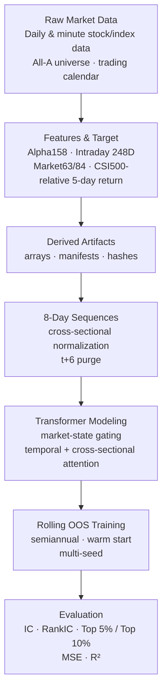

# End-to-End Stock Transformer

**English | [简体中文](README.zh-CN.md)**

This project uses **daily and minute-level A-share market data** with Transformer-based models to predict each stock's **five-trading-day excess return relative to the CSI500**. It implements a complete rolling out-of-sample research pipeline from feature and label construction to model training, cross-sectional ranking, evaluation, and selected portfolio analysis.

At each prediction date, the model processes a dynamic cross-section of A-shares. Each stock is represented by an **8-trading-day sequence**, combining **158 daily Alpha158 features** with up to **248 engineered intraday price-volume features**, while market conditions are represented separately by daily index-based features. The Transformer uses market-conditioned feature gating, temporal attention, and cross-sectional stock interaction to produce one prediction score for each stock.

**Data coverage:** market history from 2016 onward; rolling OOS prediction and evaluation from 2023 through 2026-04-27, with 2026H1 partial.

## Highlights

- Transformer-based sequence modeling with temporal attention, cross-sectional entity interaction, and market-state-conditioned feature gating.
- Multi-source, multi-frequency feature fusion combines the standard Alpha158 feature set with project-designed Intraday Price-Volume Features (248D).
- An adapted MASTER backbone is compared with GRU and Vanilla Transformer neural baselines and a LightGBM tabular baseline under one temporal protocol.
- Feature construction, model training, rolling scheduling, checkpoint/resume, and evaluation remain cleanly separated.
- Financial research uses dynamic All-A membership and a `t+1 → t+6` five-trading-day CSI500-relative target with leakage-aware purge.
- IC, RankIC, Top 5% / Top 10% returns, ablations, sensitivity studies, multi-seed robustness, and prediction-level ensembling are reported explicitly.

## Research Pipeline



The workflow writes expensive feature and label computations once as immutable derived artifacts. Training then reads those artifacts into an eight-trading-day rolling dataset; label normalization and feature preprocessing are fitted without future leakage. Data contracts, model architecture, training, rolling scheduling, and evaluation remain separate so neural and tree-based models can be compared under the same temporal protocol.

## Method

### Target and protocol

For stock \(i\) at date \(t\), the raw target is

$$
y_{i,t}=
\frac{\mathrm{AdjOpen}_{i,t+6}/\mathrm{AdjOpen}_{i,t+1}}
{\mathrm{Open}_{\mathrm{CSI500},t+6}/\mathrm{Open}_{\mathrm{CSI500},t+1}}
-1.
$$

Both offsets use one unified trading calendar. The holding period is five trading days, the future dependency reaches `t+6`, and train/validation anchors are purged when that dependency crosses a split boundary. Raw labels are normalized cross-sectionally for model fitting; IC, RankIC, and top-ranked returns are evaluated against the raw label.

### Stage 1 — MASTER baseline and research framework

Stage 1 combines the standard **Alpha158** stock feature set with **Market63** (`CSI300 + CSI500 + CSI800`, 21 features each). Alpha158 is computed directly from daily market data following the public [Microsoft Qlib](https://github.com/microsoft/qlib) definition. This stage establishes rolling OOS orchestration, prediction and evaluation, LightGBM/GRU/Transformer baselines, MASTER ablations, five loss families, hyperparameter screens, warm/cold initialization, and rolling-frequency comparisons.

The MASTER backbone, adapted from the official implementation, follows this flow: stock feature sequence → market-conditioned feature gating → linear projection and positional encoding → temporal (intra-stock) attention → cross-sectional (inter-stock) attention → temporal attention aggregation → prediction score.

### Stage 2 — Intraday Feature Design and Extension

Initially, I only had daily market data, so Stage 1 established the daily feature pipeline, market-state representation, rolling OOS protocol, and Transformer baseline. After minute-level data became available, my immediate goal was to test whether intraday information added predictive value beyond the daily representation.

To keep this comparison focused, I kept the model backbone and rolling setup broadly fixed and first compressed each stock-day's minute data into an interpretable 248D representation, which was fused with Alpha158 in the same eight-day Transformer framework. Direct modeling of raw minute-level sequences remains future work.

#### Intraday feature design

Before defining individual features, I considered which parts of intraday trading behavior I wanted to capture: distributional shape, volatility and liquidity, price-volume interaction, time-of-day and cross-session structure, frequency composition, geometric path shape, event timing, and behavior across scales. I then organized these ideas into the 11 families below and implemented the finalized F001–F248 representation.

The underlying mathematical tools—including standard statistics, FFTs, entropy, and curvature—are not original to this project. My work here is the feature selection and organization, adaptation to intraday market data, session/multiscale construction, spectral and path-shape representations, and their complete implementation as one fixed 248D system.

| Feature family | Count |
|---|---:|
| Distribution | 12 |
| Volatility | 32 |
| Liquidity | 12 |
| Price–Volume | 28 |
| Time-of-Day | 16 |
| Spectral | 21 |
| Geometry | 23 |
| Position / Session Blocks | 40 |
| Multiscale | 30 |
| Cross-Session | 22 |
| Event Timing | 12 |
| **Total** | **248** |

The formulas below are representative examples of three design ideas, not the complete definitions of all 248 features.

##### Representative example: frequency-domain representation

Minute return, absolute-return, and log-volume sequences are summarized in the frequency domain to distinguish slower and faster intraday variation and to describe spectral concentration and complexity:

$$
P_k =
\left|
\operatorname{RFFT}(x_t-\bar{x})_k
\right|^2,
$$

$$
q_k =
\frac{P_k}{\sum_j P_j}.
$$

The resulting features include low/high-frequency power share, spectral entropy, spectral centroid, dominant period, low/high log-ratio, and spectral slope. Exact band thresholds, normalization, and Fxxx mappings are given in the full specification.

##### Representative example: geometric path-shape representation

The standardized cumulative intraday return is treated as a planar path,

$$
y_j = \sum_{t=1}^{j} r_t.
$$

This makes it possible to distinguish smooth, tortuous, repeatedly reversing, or strongly bowed intraday paths even when two stocks have similar close-to-close returns. One summary is the arc-to-chord ratio:

$$
\mathrm{ArcChordRatio}
=
\frac{L_{\mathrm{arc}}}
{L_{\mathrm{chord}}}.
$$

Related features include signed and absolute chord area, maximum and RMS chord deviation, turning rate and angle, discrete curvature, curvature energy, and roughness.

##### Representative example: multiscale and session structure

Statistics, volatility concentration, and path shape are recomputed at 1m, 5m, 15m, and 30m scales. Morning/afternoon summaries, cross-session relations, and four 60-minute blocks capture where activity occurs within the trading day. Session-aware aggregation does not aggregate across the midday break.

**Full F001–F248 definitions, formulas, interpretations, and implementation mapping:** [`docs/intraday_features.md`](docs/intraday_features.md)

Design inspiration: in designing the frequency- and path-based representations, I drew on literature about frequency decomposition and functional/high-frequency market representations; the finalized feature definitions and implementation are specific to this project.

Stage 2 therefore uses `Alpha158 (158D) + Intraday Price-Volume Features (248D) = 406D` as the stock representation. The current path is minute data → stock-day 248D representation → 8-day sequence → Transformer; it does not directly feed `8 × 240` raw minute bars into the Transformer.

At each prediction date, the Stage 2 model receives `N` securities as $X_{\mathrm{stock}} \in \mathbb{R}^{N \times 8 \times 406}$, where 8 is the trading-day lookback and 406 is the fused stock representation. Market state remains a separate date-level tensor, $X_{\mathrm{market}} \in \mathbb{R}^{8 \times D_m}$ with $D_m \in \{63,84\}$, and is broadcast across the current cross-section only inside the model forward pass.

Formal Stage 2 experiments use both Market63 (63 dimensions) and Market84 (84 dimensions). Other studies cover hidden capacity, temporal/cross-sectional attention heads, and exploratory daily/intraday market gating with Intraday Market Features (192D). Cross-stage numbers are **not** a strictly matched feature ablation: no same-protocol Stage 2 Alpha158-only control is available.

## Experimental Findings

Detailed experiment tables are available in the [experiment summary](docs/experiments.md).

- **Cross-sectional interaction was one of the more consistently useful MASTER components.** Removing inter-stock interaction reduced IC and RankIC in the tested Stage 1 setting, while several other components produced metric-dependent rather than uniformly positive effects.

- **Loss functions emphasized different objectives.** CCC produced strong overall correlation and top-ranked-return performance in the tested D128 setting, while ListFold achieved the highest RankIC but weaker Top 5% / Top 10% returns. Ranking quality and extreme top-bucket returns were therefore not identical optimization objectives.

- **Standard learning-rate and dropout tuning was relatively stable in Stage 1.** Within the tested daily Market63 setting, learning-rate and dropout variants did not produce a stable large improvement, suggesting that performance was not dominated by fine tuning of these two parameters.

- **Warm start was not a dominant source of prediction quality.** The tested warm/cold rolling comparisons showed broadly similar overall behavior rather than a uniform large advantage from initialization, suggesting that refitting on each rolling training window carries much of the adaptation burden.

- **Rolling frequency interacted with model capacity rather than showing one universal optimum.** Quarterly rolling improved some D128 metrics relative to semiannual rolling, whereas monthly rolling did not show a compelling advantage. Across larger-capacity settings, the same trend was not consistently reproduced, so the capacity × rolling-frequency interaction remains under-explored.

- **More market-state dimensions did not automatically improve prediction.** Market84 produced small and mixed changes relative to Market63 in the tested Stage 2 settings, so simply enlarging the market-state vector was not enough to obtain a consistent gain.

- **Richer Stage 2 models became more configuration-sensitive.** Different capacities, temporal/cross-sectional head settings, seeds, and later market periods favored different evaluation metrics. The exploratory [dual-frequency market-state models](docs/dual_frequency.md) also showed remaining optimization and regularization headroom rather than a fully tuned optimum.

## Selected Results

The table shows a subset of representative historical experiments. Complete experiment results are available under [`results/`](results/) and in the [experiment summary](docs/experiments.md).

**Stage 1** uses Alpha158; **Stage 2** uses Alpha158 + 248D Intraday Price-Volume Features. **M63/M84** denotes the market-state configuration, **D** the hidden dimension, and **H=T×S** the temporal × cross-sectional attention heads. **Seed42** denotes a single-seed model; **Seeds42/43/44 Ensemble** denotes a prediction-level ensemble.

**Top 5% / Top 10%** denotes the top 5% / 10% of each daily stock cross-section ranked by prediction score. The reported metric is their mean five-trading-day CSI500-relative return, shown in ‰.

| Setting | IC | RankIC | Top 5% (‰) | Top 10% (‰) |
|---|---:|---:|---:|---:|
| Stage 1 · M63 · D512 · H4×2 · Seeds42/43/44 Ensemble | 0.0785 | 0.1095 | 6.450 | 5.847 |
| Stage 2 · M63 · D512 · H8×2 · Seed42 | 0.0813 | 0.1051 | 7.131 | 6.367 |
| Stage 2 · M63 · D512 · H4×4 · Seed42 | 0.0816 | 0.1069 | 6.436 | 5.812 |

### Later-period robustness: 2025H2–2026H1 partial

The long-side returns of the original daily-frequency model were relatively strong through 2025H1, but became materially more volatile and less stable from 2025H2 onward. Over the same period, market leadership also shifted, with technology and growth themes becoming more influential. Stage 2 therefore evaluates not only full-period IC, RankIC, and top-ranked returns, but also robustness during the later 2025H2–2026H1 regime.

For context, the **Stage 1 · M63 · D512 · H4×2 · Seeds42/43/44 Ensemble** recorded Top 5% / Top 10% returns of 14.511‰ / 13.542‰ in 2025H1, 1.193‰ / 0.452‰ in 2025H2, and 2.476‰ / 1.984‰ in 2026H1 partial.

| Setting | 2025H2 Top 5% | 2025H2 Top 10% | 2026H1 partial Top 5% | 2026H1 partial Top 10% |
|---|---:|---:|---:|---:|
| Stage 2 · M63 · D512 · H8×2 · Seed42 | 4.034‰ | 2.614‰ | -0.394‰ | -0.649‰ |
| Stage 2 · M63 · D512 · H4×4 · Seed42 | 2.008‰ | 1.058‰ | 1.166‰ | 0.580‰ |
| Stage 2 · M63 · D512 · H4×2 · Seed42 | 3.780‰ | 2.687‰ | -0.275‰ | -0.418‰ |
| Stage 2 · M63 · D512 · H4×2 · Seed44 | 0.191‰ | -0.462‰ | 1.277‰ | 1.117‰ |

The differences across attention settings, seeds, and the two later periods show clear regime and configuration dependence; no setting leads across every period and metric.

## Selected Portfolio Evaluation

These results come from the internal portfolio backtest used during the internship and provide a complementary view of signal selection quality; transaction fees were not deducted. Only selected signals entered this backtest, so the results are not a controlled comparison across all experiments.

| Setting | Long Ann. Return | Long Sharpe | Long-Short Ann. Return | Long-Short Sharpe | Mean Turnover |
|---|---:|---:|---:|---:|---:|
| LightGBM · Stage 1 · M63 · Seed42 | 10.6% | 0.684 | 89.7% | 5.128 | 41.1% |
| Stage 1 · M63 · D128 · H4×1 · Seeds42/43/44 Ensemble | 17.1% | 1.052 | 108.0% | 5.625 | 27.1% |
| Stage 2 · M63 · D256 · H4×2 · Seed43 | 18.3% | 1.119 | 108.3% | 6.108 | 37.6% |
| Stage 2 · M63 · D512 · H4×2 · Seed42 | 21.4% | 1.363 | 110.9% | 6.711 | 54.1% |

The long portfolio follows the historical backtest system's portfolio definition and is separate from the prediction Top 5% / Top 10% metrics. Among the representative runs shown here, the D512 intraday model has higher portfolio return and Sharpe, together with higher mean turnover. Full aggregate statistics and limitations are in [portfolio evaluation](docs/portfolio_evaluation.md).

## Open Directions

- **Direct minute-sequence modeling.** The current Stage 2 pipeline compresses each stock-day into a 248D representation before the eight-day Transformer. A natural extension is to introduce a dedicated intraday encoder that directly consumes minute-level stock sequences and learns the daily representation jointly with the downstream return-prediction model.

- **Intraday market-state modeling.** The exploratory [dual-frequency experiments](docs/dual_frequency.md) indicate that richer daily + intraday market guidance is worth further study. Learning rate, dropout/regularization, capacity, and routing/gating structure were not exhaustively tuned within the project scope.

- **Capacity × rolling-frequency interaction.** The different trends observed across smaller and larger models motivate a systematic study of whether shorter retraining intervals help only certain capacity regimes or under particular market conditions.

## Experimental Design

- Dynamic All A-share membership by date.
- Eight-trading-day stock and market lookback.
- Data history: 2016 onward.
- Rolling OOS prediction and evaluation: 2023 through 2026-04-27 (partial 2026H1).
- Representative portfolio backtests: 2023 through 2026-04-27.
- Semiannual rolling OOS is the main protocol; quarterly and monthly rolling are included as additional frequency experiments, with details in the [experiment summary](docs/experiments.md).
- Warm-start checkpoints restricted by model, seed, and feature-layout compatibility.
- Independent seed metrics, robustness mean/std, and raw-score ensembles stored as different result types.
- IC, RankIC, Top 5%, Top 10%, MSE, and R² computed by the shared evaluator.

## Repository Structure

```text
src/        canonical Python package
configs/    self-describing Stage 1, Stage 2, secondary, and exploratory configs
scripts/    public feature/label builders and rolling entry point
tests/      canonical unit, integration, contract, and presentation tests
results/    normalized result tables, metadata registries, metric definitions, and provenance
docs/       data, reproducibility, experiment, and provenance documentation
```

## Quick Start

```bash
pip install -e .
# Optional: pip install -e ".[parquet,test]"

python scripts/build_relative_excess_label.py \
  --stock-daily data/daily_stock.parquet \
  --benchmark-daily data/daily_index.parquet \
  --calendar data/calendar.csv \
  --output data/derived/relative_excess_return_5d.pkl

python scripts/build_daily_features.py alpha158 \
  --input data/daily_stock.parquet \
  --output data/derived/alpha158

python scripts/build_daily_features.py market63 \
  --input data/daily_index.parquet \
  --output data/derived/market63

python scripts/build_intraday_features.py intraday_price_volume \
  --input data/minute_stock.parquet \
  --output data/derived/intraday_price_volume

python scripts/run_rolling.py configs/stage2/intraday_price_volume_master_d512_market63.json
# Requires the optional test dependency.
pytest
```

The repository does not ship raw market data. Prepare your own data according to the documented [data contracts](docs/data_contract.md); paths above are examples only.

## Reproducibility and Limitations

Historical experiments started from basic market data provided in the internship environment: daily and minute stock data, index data, dynamic-universe membership, and a trading calendar. The project did not use a company factor library as model input: standard Alpha158 features are computed from daily market data, while the 248-dimensional Intraday Price-Volume Features are designed in this project and constructed from minute data. Raw market data cannot be redistributed because of licensing and compliance constraints. Reproducing historical metrics still requires equivalent data coverage and compute. See [data contracts](docs/data_contract.md) and [reproducibility](docs/reproducibility.md).

The historical results are research evidence, not claims of tradable performance. The selected portfolio statistics came from the internal historical backtesting system used during the internship, and transaction fees were not deducted. The public repository retains the reported aggregates and known conventions, while complete internal execution settings and implementation details were not fully recorded in this project. Stage 2 lacks an exact matched Alpha158-only control, and several experiments are explicitly partial.

## Attribution

The MASTER backbone is adapted from the official [SJTU-DMTai/MASTER](https://github.com/SJTU-DMTai/MASTER) implementation for **Li et al., “MASTER: Market-Guided Stock Transformer for Stock Price Forecasting,” AAAI 2024** ([paper](https://ojs.aaai.org/index.php/AAAI/article/view/27767)). The exact historical upstream commit was not recorded. The standard Alpha158 feature implementation is a pandas/NumPy adaptation of Microsoft Qlib's `Alpha158DL` definition.

Building on this backbone, this repository implements the rolling OOS training and evaluation framework, leakage-aware label/data pipeline, GRU / Vanilla Transformer / LightGBM baselines, ablation/loss/hyperparameter experiments, intraday price-volume features, Market84 and intraday-market extensions, multi-seed evaluation, and result provenance. See [third-party notices](THIRD_PARTY_NOTICES.md) for upstream copyright and license information.

## License

This repository is released under the [MIT License](LICENSE). Adapted MASTER and Qlib Alpha158 portions retain their upstream MIT copyright and permission notices in [THIRD_PARTY_NOTICES.md](THIRD_PARTY_NOTICES.md).
