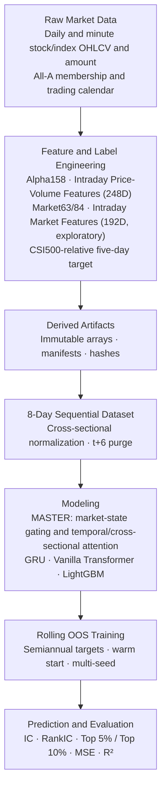

# Market-Guided Stock Alpha

**English | [简体中文](README.zh-CN.md)**

**A deep-learning research and engineering framework for multivariate sequential prediction, developed for cross-sectional stock-return forecasting with market-guided Transformers and intraday price-volume representations.**

The project studies daily cross-sectional return forecasting over **dynamic All A-shares**, with a five-trading-day forward return target relative to CSI500. Building on the daily-frequency MASTER framework, it investigates whether project-designed minute-level price-volume features provide additional predictive information. The repository covers rolling out-of-sample training, neural and tree-based baselines, multi-seed evaluation, prediction-level ensembling, and selected portfolio evaluation.

## Highlights

- Transformer-based sequence modeling with temporal attention, cross-sectional entity interaction, and market-state-conditioned feature gating.
- Multi-source, multi-frequency feature fusion combines the standard Alpha158 feature set with project-designed Intraday Price-Volume Features (248D).
- An adapted MASTER backbone is compared with GRU and Vanilla Transformer neural baselines and a LightGBM tabular baseline under one temporal protocol.
- Feature construction, model training, rolling scheduling, checkpoint/resume, and evaluation remain cleanly separated.
- Financial research uses dynamic All-A membership and a `t+1 → t+6` five-trading-day CSI500-relative target with leakage-aware purge.
- IC, RankIC, Top 5% / Top 10% returns, ablations, sensitivity studies, multi-seed robustness, and prediction-level ensembling are reported explicitly.

## Research Pipeline



The workflow writes expensive feature and label computations once as immutable derived artifacts. Training then reads those artifacts into an eight-trading-day rolling dataset; label normalization and feature preprocessing are fitted without future leakage. Data contracts, model architecture, training, rolling scheduling, and evaluation remain separate so neural and tree-based models can be compared under the same temporal protocol.

## Method

### Target and protocol

For stock \(i\) at date \(t\), the raw target is

$$
y_{i,t}=
\frac{\mathrm{AdjOpen}_{i,t+6}/\mathrm{AdjOpen}_{i,t+1}}
{\mathrm{Open}_{\mathrm{CSI500},t+6}/\mathrm{Open}_{\mathrm{CSI500},t+1}}
-1.
$$

Both offsets use one unified trading calendar. The holding period is five trading days, the future dependency reaches `t+6`, and train/validation anchors are purged when that dependency crosses a split boundary. Raw labels are normalized cross-sectionally for model fitting; IC, RankIC, and top-ranked returns are evaluated against the raw label.

### Stage 1 — MASTER baseline and research framework

Stage 1 combines the standard **Alpha158** stock feature set with **Market63** (`CSI300 + CSI500 + CSI800`, 21 features each). Alpha158 is computed from basic daily market data using a pandas/NumPy adaptation of the Microsoft Qlib definition. This stage establishes rolling OOS orchestration, prediction and evaluation, LightGBM/GRU/Transformer baselines, MASTER ablations, five loss families, hyperparameter screens, warm/cold initialization, and rolling-frequency comparisons.

The MASTER backbone, adapted from the official implementation, follows this flow: stock feature sequence → market-conditioned feature gating → linear projection and positional encoding → temporal (intra-stock) attention → cross-sectional (inter-stock) attention → temporal attention aggregation → prediction score.

### Stage 2 — intraday extension

Stage 2 extends each stock input to `Alpha158 (158) + Intraday Price-Volume Features (248D) = 406` features. The 248-dimensional minute-level price-volume representation is designed in this project. Formal Stage 2 experiments use both Market63 (63 dimensions) and Market84 (84 dimensions), giving conceptual combined dimensions of 469 and 490 respectively. Other studies cover hidden capacity, temporal/spatial attention heads, and exploratory daily/intraday market gating with Intraday Market Features (192D). Cross-stage numbers are **not** a strictly matched feature ablation: no same-protocol Stage 2 Alpha158-only control is available.

At each prediction date, the Stage 2 model receives `N` securities as $X_{\mathrm{stock}} \in \mathbb{R}^{N \times 8 \times 406}$, where 8 is the trading-day lookback and 406 is the fused stock representation. Market state remains a separate date-level tensor, $X_{\mathrm{market}} \in \mathbb{R}^{8 \times D_m}$ with $D_m \in \{63,84\}$, and is broadcast across the current cross-section only inside the model forward pass.

Historical market data extend back to 2016; rolling OOS prediction and evaluation begin in 2023, with the current results ending on 2026-04-27.

## Prediction Quality

The table reports **mean ± sample standard deviation across three independently trained seeds** and shows representative complete Stage 1 and Stage 2 experiments. Cross-stage rows are historical research results, not a strictly matched feature ablation.

Prediction **Top 5% / Top 10%** means the top fraction of each daily stock cross-section ranked by model score. Return columns report mean five-trading-day CSI500-relative returns, shown in ‰.

| Setting | IC | RankIC | Top 5% mean 5-day relative return (‰) | Top 10% mean 5-day relative return (‰) |
|---|---:|---:|---:|---:|
| Stage 1 · Alpha158 · Market63 · D128 | 0.0664 ± 0.0017 | 0.0966 ± 0.0020 | — | — |
| Stage 2 · Alpha158 + intraday · Market63 · D256 | 0.0796 ± 0.0002 | 0.0994 ± 0.0055 | 6.218 ± 0.260 | 5.419 ± 0.204 |
| Stage 2 · Alpha158 + intraday · Market63 · D512 | 0.0779 ± 0.0042 | 0.1015 ± 0.0011 | 6.369 ± 0.568 | 5.699 ± 0.553 |
| Stage 2 · Alpha158 + intraday · Market84 · D256 | 0.0800 ± 0.0020 | 0.1006 ± 0.0037 | 5.914 ± 0.457 | 5.307 ± 0.313 |

`—` means that a complete three-seed Top 5% / Top 10% statistic was not available for the selected Stage 1 setting. Stage 1 prediction-level ensemble results are included in the detailed [experiments](docs/experiments.md) and [results provenance](docs/results_provenance.md). Stage 2 D128 has partial seed coverage and is not included in the main table.

## Selected Portfolio Evaluation

These results come from the internal portfolio backtest used during the internship and provide a complementary view of signal selection quality; transaction fees were not deducted. Only selected signals entered this backtest, so the results are not a controlled comparison across all experiments.

| Signal | Long Ann. Return | Long Sharpe | Long-Short Ann. Return | Long-Short Sharpe | Mean Turnover |
|---|---:|---:|---:|---:|---:|
| LightGBM · Alpha158 · Market63 | 10.6% | 0.684 | 89.7% | 5.128 | 41.1% |
| MASTER D128 · Alpha158 · Market63 · 3-seed prediction ensemble | 17.1% | 1.052 | 108.0% | 5.625 | 27.1% |
| MASTER D256 · Alpha158 + intraday · Market63 · seed43 | 18.3% | 1.119 | 108.3% | 6.108 | 37.6% |
| MASTER D512 · Alpha158 + intraday · Market63 · seed42 | 21.4% | 1.363 | 110.9% | 6.711 | 54.1% |

The long portfolio follows the historical backtest system's portfolio definition and is separate from the prediction Top 5% / Top 10% metrics. Among the representative runs shown here, the D512 intraday model has higher portfolio return and Sharpe, together with higher mean turnover. Full aggregate statistics and limitations are in [portfolio evaluation](docs/portfolio_evaluation.md).

## Experimental Design

- Dynamic All A-share membership by date.
- Eight-trading-day stock and market lookback.
- Data history: 2016 onward.
- Rolling OOS prediction and evaluation: 2023 through 2026-04-27 (partial 2026H1).
- Representative portfolio backtests: 2023 through 2026-04-27.
- Semiannual rolling OOS is the main protocol; quarterly and monthly rolling are included as additional frequency experiments, with details in the [experiment summary](docs/experiments.md).
- Warm-start checkpoints restricted by model, seed, and feature-layout compatibility.
- Independent seed metrics, robustness mean/std, and raw-score ensembles stored as different result types.
- IC, RankIC, Top 5%, Top 10%, MSE, and R² computed by the shared evaluator.

## Repository Structure

```text
src/        canonical Python package
configs/    self-describing Stage 1, Stage 2, secondary, and exploratory configs
scripts/    public feature/label builders and rolling entry point
tests/      canonical unit, integration, contract, and presentation tests
results/    normalized result tables, metadata registries, metric definitions, and provenance
docs/       data, reproducibility, experiment, and provenance documentation
```

## Quick Start

```bash
pip install -e .
# Optional: pip install -e ".[parquet,test]"

python scripts/build_relative_excess_label.py \
  --stock-daily data/daily_stock.parquet \
  --benchmark-daily data/daily_index.parquet \
  --calendar data/calendar.csv \
  --output data/derived/relative_excess_return_5d.pkl

python scripts/build_daily_features.py alpha158 \
  --input data/daily_stock.parquet \
  --output data/derived/alpha158

python scripts/build_daily_features.py market63 \
  --input data/daily_index.parquet \
  --output data/derived/market63

python scripts/build_intraday_features.py intraday_price_volume \
  --input data/minute_stock.parquet \
  --output data/derived/intraday_price_volume

python scripts/run_rolling.py configs/stage2/intraday_price_volume_master_d512_market63.json
# Requires the optional test dependency.
pytest
```

The repository does not ship raw market data. Prepare your own data according to the documented [data contracts](docs/data_contract.md); paths above are examples only.

## Reproducibility and Limitations

Historical experiments started from basic market data provided in the internship environment: daily and minute stock data, index data, dynamic-universe membership, and a trading calendar. The project did not use a company factor library as model input: standard Alpha158 features are computed from daily market data, while the 248-dimensional Intraday Price-Volume Features are designed in this project and constructed from minute data. Raw market data cannot be redistributed because of licensing and compliance constraints. Reproducing historical metrics still requires equivalent data coverage and compute. See [data contracts](docs/data_contract.md) and [reproducibility](docs/reproducibility.md).

The historical results are research evidence, not claims of tradable performance. The selected portfolio statistics come from an internal historical engine, do not deduct transaction fees, and cannot be reproduced from the public repository alone. Stage 2 lacks an exact matched Alpha158-only control, and several experiments are explicitly partial.

## Attribution

The MASTER backbone is adapted from the official [SJTU-DMTai/MASTER](https://github.com/SJTU-DMTai/MASTER) implementation for **Li et al., “MASTER: Market-Guided Stock Transformer for Stock Price Forecasting,” AAAI 2024** ([paper](https://ojs.aaai.org/index.php/AAAI/article/view/27767)). The exact historical upstream commit was not recorded. The standard Alpha158 feature implementation is a pandas/NumPy adaptation of Microsoft Qlib's `Alpha158DL` definition.

Building on this backbone, this repository implements the rolling OOS training and evaluation framework, leakage-aware label/data pipeline, GRU / Vanilla Transformer / LightGBM baselines, ablation/loss/hyperparameter experiments, intraday price-volume features, Market84 and intraday-market extensions, multi-seed evaluation, and result provenance. See [third-party notices](THIRD_PARTY_NOTICES.md) for upstream copyright and license information.

## License

This repository is released under the [MIT License](LICENSE). Adapted MASTER and Qlib Alpha158 portions retain their upstream MIT copyright and permission notices in [THIRD_PARTY_NOTICES.md](THIRD_PARTY_NOTICES.md).
