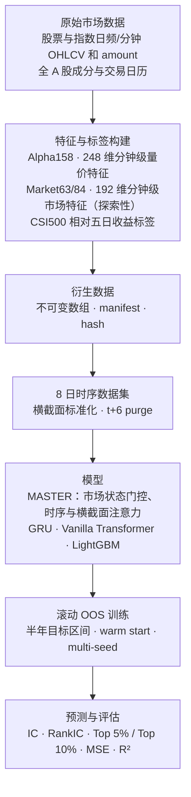

# Market-Guided Stock Alpha

**[English](README.md) | 简体中文**

**基于 Transformer 的多源时序预测研究与工程框架，面向 A 股横截面收益预测，融合日频因子、分钟级量价特征与市场状态信息。**

项目面向**动态全 A 股**的日频横截面收益预测，预测目标为相对 CSI500 的未来五交易日收益。在 MASTER 日频框架基础上，本项目重点研究自设计的分钟级量价特征能否为日频横截面收益预测提供额外信息，并覆盖滚动 OOS 训练、神经网络与树模型基线、多 seed 稳健性评估、预测集成和代表性组合回测。

## 核心特点

- 基于 Transformer 的时序建模，包含时序注意力、横截面股票间交互和市场状态门控。
- 多源、多频特征融合：标准 Alpha158 特征与本项目设计的 Intraday Price-Volume Features（248 维分钟级量价特征）。
- 采用改造后的 MASTER backbone，并在同一时间协议下比较 GRU、Vanilla Transformer（标准 Transformer 基线）和 LightGBM。
- 特征构建、模型训练、滚动调度、checkpoint/resume 和评估相互分离。
- 使用动态全 A 股成分与 `t+1 → t+6` 的五交易日 CSI500 相对收益标签，并根据未来依赖进行边界 purge，避免数据泄漏。
- 明确报告 IC、RankIC、Top 5% / Top 10% 收益、消融实验、敏感性实验、多 seed 稳健性和预测集成。

## 研究流程



高成本的特征与标签只离线计算一次，并写入带 manifest/hash 的不可变衍生数据。训练阶段读取这些数据构造 8 个交易日的时序样本；标签标准化和特征预处理不会使用未来信息。数据契约、模型结构、训练、滚动调度和评估各自独立，使神经网络与树模型能够在统一时间协议下比较。

## 方法

### 标签与实验协议

股票 \(i\) 在日期 \(t\) 的原始标签定义为：

$$
y_{i,t}=
\frac{\mathrm{AdjOpen}_{i,t+6}/\mathrm{AdjOpen}_{i,t+1}}
{\mathrm{Open}_{\mathrm{CSI500},t+6}/\mathrm{Open}_{\mathrm{CSI500},t+1}}
-1.
$$

`t+1` 和 `t+6` 使用统一交易日历定位，对应五个交易日持有区间；根据 `t+6` 的未来依赖执行边界 purge，避免未来信息跨越训练/验证切分。模型训练使用横截面标准化后的标签，IC、RankIC 和排名靠前股票收益使用原始标签评估。

### Stage 1 — MASTER 基线与研究框架

Stage 1 使用标准 **Alpha158** 股票特征和 **Market63**（`CSI300 + CSI500 + CSI800`，每个指数 21 维）。Alpha158 按 Microsoft Qlib 的公开定义进行 pandas/NumPy 适配，并由日频基础行情计算。该阶段建立了滚动 OOS、预测与评估、LightGBM/GRU/Transformer 基线、MASTER 消融、五类 loss、超参数筛选、warm start / cold start 和滚动频率比较。

MASTER backbone 基于官方实现改造，结构流程为：股票特征序列 → 市场状态条件化特征门控 → 线性投影与位置编码 → 时序（单只股票内部）注意力 → 横截面（股票之间）注意力 → 时序注意力聚合 → 预测分数。

### Stage 2 — 分钟级扩展

Stage 2 的股票输入为 `Alpha158 (158) + Intraday Price-Volume Features (248D) = 406` 维，其中 248 维分钟级量价特征由本项目设计。正式 Stage 2 实验同时使用 Market63（63 维）和 Market84（84 维），概念上的合计输入维数分别为 469 和 490。其他实验覆盖模型容量、时序/横截面 attention heads，以及使用 Intraday Market Features（192 维分钟级市场特征）的探索性日频/分钟级市场门控。

每个预测日的股票张量为 $X_{\mathrm{stock}} \in \mathbb{R}^{N \times 8 \times 406}$，其中 `N` 是当日股票数，8 是回看交易日数。市场状态保持为独立的 $X_{\mathrm{market}} \in \mathbb{R}^{8 \times D_m}$，其中 $D_m \in \{63,84\}$；只在模型 forward 内对当日股票横截面进行广播。

Stage 1 与 Stage 2 **不是**严格匹配的特征消融：当前没有采用相同 Stage 2 协议的 Alpha158-only matched control。

历史行情覆盖自 2016 年起，滚动 OOS 预测与评价从 2023 年开始，当前结果截至 2026-04-27。

## 预测质量

主表报告三个独立训练 seed 的**均值 ± 样本标准差**，并选取 Stage 1 与 Stage 2 的代表性完整实验。跨 Stage 行属于历史研究结果，不构成严格匹配的特征消融。

预测指标中的 **Top 5% / Top 10%** 指每日股票横截面按模型分数排序后的前 5% / 10%。收益列为对应股票的五交易日 CSI500 相对收益均值，单位为 ‰。

| 设置 | IC | RankIC | Top 5% 平均五日相对收益（‰） | Top 10% 平均五日相对收益（‰） |
|---|---:|---:|---:|---:|
| Stage 1 · Alpha158 · Market63 · D128 | 0.0664 ± 0.0017 | 0.0966 ± 0.0020 | — | — |
| Stage 2 · Alpha158 + 分钟级量价 · Market63 · D256 | 0.0796 ± 0.0002 | 0.0994 ± 0.0055 | 6.218 ± 0.260 | 5.419 ± 0.204 |
| Stage 2 · Alpha158 + 分钟级量价 · Market63 · D512 | 0.0779 ± 0.0042 | 0.1015 ± 0.0011 | 6.369 ± 0.568 | 5.699 ± 0.553 |
| Stage 2 · Alpha158 + 分钟级量价 · Market84 · D256 | 0.0800 ± 0.0020 | 0.1006 ± 0.0037 | 5.914 ± 0.457 | 5.307 ± 0.313 |

`—` 表示所选 Stage 1 设置没有完整的三 seed Top 5% / Top 10% 统计。Stage 1 的预测集成结果见[实验汇总](docs/experiments.md)和[结果溯源说明](docs/results_provenance.md)。Stage 2 D128 的 seed 覆盖不完整，因此未放入主表。

## 代表性组合回测结果

以下结果来自实习期间使用的内部组合回测，用于补充评估信号的选股能力，未扣除交易手续费。只有部分代表性信号进入该回测，因此结果不构成全部实验的严格对照。

| 信号 | 多头年化收益 | 多头 Sharpe | 多空年化收益 | 多空 Sharpe | 平均换手率 |
|---|---:|---:|---:|---:|---:|
| LightGBM · Alpha158 · Market63 | 10.6% | 0.684 | 89.7% | 5.128 | 41.1% |
| MASTER D128 · Alpha158 · Market63 · 3-seed 预测集成 | 17.1% | 1.052 | 108.0% | 5.625 | 27.1% |
| MASTER D256 · Alpha158 + 分钟级量价 · Market63 · seed43 | 18.3% | 1.119 | 108.3% | 6.108 | 37.6% |
| MASTER D512 · Alpha158 + 分钟级量价 · Market63 · seed42 | 21.4% | 1.363 | 110.9% | 6.711 | 54.1% |

表中的多头组合沿用历史回测系统的组合定义，与前述 Top 5% / Top 10% 预测指标相互独立。在所展示的代表性结果中，D512 分钟级模型取得较高的组合收益和 Sharpe，同时平均换手率也更高。完整结果和方法边界见[组合回测说明](docs/portfolio_evaluation.md)。

## 实验设计

- 按日期变化的动态全 A 股股票池。
- 股票与市场状态均使用 8 个交易日回看窗口。
- 数据历史：2016 年起。
- 滚动 OOS 预测与评价：2023 年至 2026-04-27（2026H1 尚未完整结束）。
- 代表性组合回测：2023 年至 2026-04-27。
- 主实验采用半年滚动 OOS；季度和月度滚动作为补充频率实验，详见[实验汇总](docs/experiments.md)。
- warm start checkpoint 必须满足模型、seed 和 feature layout 兼容性。
- 单 seed 指标、跨 seed 稳健性均值/标准差和原始预测集成分别存储。
- 统一评估器计算 IC、RankIC、Top 5%、Top 10%、MSE 和 R²。

## 目录结构

```text
src/        核心 Python 包
configs/    Stage 1、Stage 2、次要与探索性实验 config
scripts/    公开特征/标签 builder 与 rolling 入口
tests/      公开版单元、集成、契约与展示测试
results/    标准化结果表、历史 metadata registry、指标定义与结果溯源
docs/       数据、复现、实验与结果溯源文档
```

## 快速开始

```bash
pip install -e .
# 可选：pip install -e ".[parquet,test]"

python scripts/build_relative_excess_label.py \
  --stock-daily data/daily_stock.parquet \
  --benchmark-daily data/daily_index.parquet \
  --calendar data/calendar.csv \
  --output data/derived/relative_excess_return_5d.pkl

python scripts/build_daily_features.py alpha158 \
  --input data/daily_stock.parquet \
  --output data/derived/alpha158

python scripts/build_daily_features.py market63 \
  --input data/daily_index.parquet \
  --output data/derived/market63

python scripts/build_intraday_features.py intraday_price_volume \
  --input data/minute_stock.parquet \
  --output data/derived/intraday_price_volume

python scripts/run_rolling.py configs/stage2/intraday_price_volume_master_d512_market63.json
pytest
```

仓库不包含原始市场数据。请按照[公开数据契约](docs/data_contract.md)准备自己的数据；以上路径仅为示例。

## 复现范围与限制

历史实验从实习环境提供的基础市场数据出发，包括股票日频与分钟行情、指数行情、动态股票池和交易日历。本项目没有把公司内部因子库作为模型输入：Alpha158 按公开标准定义从日频行情计算，248 维 Intraday Price-Volume Features 则由本项目设计并从分钟行情构造。由于数据授权与合规限制，原始行情不随仓库发布；复现历史指标仍需准备覆盖范围相当的数据和算力。详见[数据契约](docs/data_contract.md)与[复现说明](docs/reproducibility.md)。

历史结果属于研究证据，不代表可交易业绩。所展示的组合统计来自历史内部回测系统，未扣除交易手续费，也不能仅凭公开仓库复现。Stage 2 缺少严格匹配的 Alpha158-only control，部分实验也明确为不完整覆盖。

## 上游来源与第三方许可

MASTER backbone 基于 **Li et al., “MASTER: Market-Guided Stock Transformer for Stock Price Forecasting,” AAAI 2024** 的[官方实现](https://github.com/SJTU-DMTai/MASTER)进行适配，论文见[此处](https://ojs.aaai.org/index.php/AAAI/article/view/27767)。历史实验所使用的确切 upstream commit 未被记录。标准 Alpha158 实现则是对 Microsoft Qlib `Alpha158DL` 定义的 pandas/NumPy 适配。

在此基础上，本项目主要完成了滚动 OOS 训练与评估框架、防未来信息泄漏的标签与数据流程、GRU / Vanilla Transformer / LightGBM 基线集成、消融与 loss / 参数实验体系、248 维分钟级量价特征、Market84 与分钟级市场状态扩展，以及 multi-seed 评估和结果溯源。第三方版权与许可信息见[第三方声明](THIRD_PARTY_NOTICES.md)。

## License

本仓库采用 [MIT License](LICENSE)。MASTER 与 Qlib Alpha158 的适配部分保留上游 MIT 版权与许可声明，详见 [THIRD_PARTY_NOTICES.md](THIRD_PARTY_NOTICES.md)。
