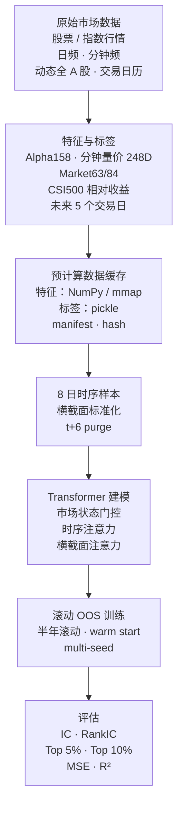

# End-to-End Stock Transformer

**[English](README.md) | 简体中文**

本项目使用 **A 股日频与分钟级行情数据**，基于 Transformer 模型预测每只股票未来 **5 个交易日相对于中证500的超额收益**。项目实现了一套完整的滚动样本外研究流程，覆盖特征与标签构建、模型训练、横截面股票排序、预测评价以及部分组合回测分析。

在每个预测日，模型面对一个股票数量动态变化的 A 股横截面。每只股票由过去 **8 个交易日的时序数据**表示，其中包括 **158 维日频 Alpha158 特征**以及最多 **248 维分钟级量价衍生特征**；市场状态则由独立的指数日频特征表示。Transformer 通过市场状态引导的特征门控、时间维注意力以及股票间横截面注意力，为每只股票输出一个预测分数。

**数据范围：** 历史行情自 2016 年起；滚动 OOS 预测与评价为 2023 年至 2026-04-27，其中 2026H1 为未完整区间。

## 项目实现内容

- 搭建从原始市场行情到标准 Alpha158、Market63/84 和 CSI500 相对收益标签的完整计算流程。
- 实现随日期变化的全 A 股股票池、统一交易日历，以及滚动切分中的 `t+6` 未来依赖 purge。
- 构建预计算 NumPy/mmap 特征缓存、离线标签文件及 manifest/hash 校验，使滚动窗口能够稳定复用计算结果。
- 将公开 MASTER backbone 适配为滚动 OOS 训练与评估系统，并实现 checkpoint/resume、warm/cold initialization 和 multi-seed 调度。
- 实现 LightGBM、GRU、Vanilla Transformer 基线，以及消融、loss、超参数和滚动频率实验。
- 设计并实现一套结构化的 248 维分钟级量价特征系统，用于检验分钟信息能否补充日频 Alpha158 表示。

## 代表性结果

- 在下文选取的不同历史配置中，代表性滚动 OOS 结果最高达到 IC 0.0816、RankIC 0.1095，以及 Top 5% 五交易日 CSI500 相对收益 7.131‰。
- 在 Stage 1 的受控消融实验中，移除股票间横截面交互后，IC 和 RankIC 均下降。
- 这些结果来自不同的历史配置，不构成严格匹配的 Stage 1 与 Stage 2 特征消融结论。

## 研究流程



Alpha158、248 维分钟量价特征、Market63/84 和标签等高成本结果只计算一次，并缓存供滚动训练复用。特征结果保存为支持 mmap 读取的 NumPy 数组，标签则单独保存为 pickle 文件。训练阶段从这些预计算结果中构造 8 个交易日的时序样本；标签标准化和特征预处理只在对应训练数据上拟合，避免未来信息泄漏。manifest 和 hash 用于记录数据维度、日期、特征顺序、来源信息并校验文件完整性。这样可以避免反复读取原始日频/分钟行情和重复执行高成本特征计算，同时保持数据处理、模型、滚动调度与评估相互分离。

## 方法

### 标签与实验协议

股票 $i$ 在日期 $t$ 的原始标签定义为：

$$
y_{i,t}=
\frac{\mathrm{AdjOpen}_{i,t+6}/\mathrm{AdjOpen}_{i,t+1}}
{\mathrm{Open}_{\mathrm{CSI500},t+6}/\mathrm{Open}_{\mathrm{CSI500},t+1}}
-1.
$$

`t+1` 和 `t+6` 使用统一交易日历定位，对应五个交易日持有区间；根据 `t+6` 的未来依赖执行边界 purge，避免未来信息跨越训练/验证切分。模型训练使用横截面标准化后的标签，IC、RankIC 和排名靠前股票收益使用原始标签评估。

### Stage 1 — MASTER 基线与研究框架

Stage 1 使用标准 **Alpha158** 股票特征和 **Market63**（`CSI300 + CSI500 + CSI800`，每个指数 21 维）。Alpha158 按 [Microsoft Qlib](https://github.com/microsoft/qlib) 的公开定义直接由日频基础行情计算。该阶段建立了滚动 OOS、预测与评估、LightGBM/GRU/Transformer 基线、MASTER 消融、五类 loss、超参数筛选、warm start / cold start 和滚动频率比较。

MASTER backbone 基于官方实现改造，结构流程为：股票特征序列 → 市场状态引导的特征门控 → 线性投影与位置编码 → 时序（单只股票内部）注意力 → 横截面（股票之间）注意力 → 时序注意力聚合 → 预测分数。

### Stage 2 — 分钟级量价特征设计与扩展

项目初期仅有日频行情，因此 Stage 1 首先建立了日频特征、市场状态、滚动 OOS 与 Transformer 预测框架。后续获得分钟级行情后，Stage 2 重点检验日内信息能否在日频表示之外增加预测价值。

为使这一比较尽量集中，模型主干与滚动设置基本保持不变。每个 stock-day 的分钟行情先压缩为 248 维可解释表示，再与 Alpha158 融合输入同一套 8 日 Transformer 框架。直接建模原始分钟序列留作后续研究。

#### 分钟级特征设计

特征设计围绕以下日内交易信息展开：分布形态、波动与流动性、量价互动、日内时段与跨时段结构、频率组成、几何路径形态、事件时点以及多尺度行为。这些思路随后被组织为下表中的 11 类，并实现为最终的 F001–F248 表示。

其中使用的标准统计方法、FFT、熵和曲率等数学工具本身并非本项目原创。本项目的工作主要体现在特征选择与组织、面向日内行情的适配、时段与多尺度构造、频域与路径形态表示，以及将这些部分完整实现为一套固定的 248D 特征系统。

| 特征族 | 数量 |
|---|---:|
| 分布（Distribution） | 12 |
| 波动率（Volatility） | 32 |
| 流动性（Liquidity） | 12 |
| 量价关系（Price–Volume） | 28 |
| 日内时段（Time-of-Day） | 16 |
| 频域（Spectral） | 21 |
| 几何路径（Geometry） | 23 |
| 位置 / 时段分块（Position / Session Blocks） | 40 |
| 多尺度（Multiscale） | 30 |
| 跨时段（Cross-Session） | 22 |
| 事件时点（Event Timing） | 12 |
| **合计** | **248** |

以下公式只是三类设计思路的代表性示例，并非 248 个特征的全部定义。

##### 代表性示例：频域表示（Spectral）

分钟收益、绝对收益和对数成交量序列在频域中进行概括，用于区分较慢与较快的日内变化，并描述频谱集中程度与复杂度：

$$
P_k =
\left|
\mathrm{RFFT}(x_t-\bar{x})_k
\right|^2,
$$

$$
q_k =
\frac{P_k}{\sum_j P_j}.
$$

相应特征包括低/高频功率占比、谱熵、谱质心、主导周期、低高频对数比和谱斜率。具体频带阈值、归一化方式与 Fxxx 映射见完整特征文档。

##### 代表性示例：几何路径表示（Geometry）

将标准化后的日内累计收益视为平面路径：

$$
y_j = \sum_{t=1}^{j} r_t.
$$

因此，即使两只股票具有相近的收盘收益，也可以区分其盘中路径是平滑、曲折、反复还是显著偏离首尾直线。其中一个概括量是弧弦比：

$$
\mathrm{ArcChordRatio} =
\frac{L_{\mathrm{arc}}}{L_{\mathrm{chord}}}.
$$

相关特征还包括有符号/绝对弦面积、最大/RMS 弦偏离、转向率与转向角、离散曲率、曲率能量和粗糙度。

##### 代表性示例：多尺度与时段结构（Multiscale）

统计量、波动集中度与路径形态还会在 1m、5m、15m、30m 等尺度重新描述。morning / afternoon 汇总、cross-session 关系以及四个 60 分钟分块用于刻画交易日在不同时段的结构。时段感知聚合不会跨越午间休市进行合并。

**完整 F001–F248 定义、公式、含义及实现映射：** [`docs/intraday_features.md`](docs/intraday_features.md)

设计参考了频率分解、函数型数据分析以及高频市场表示相关研究；最终特征定义及其实现由本项目面向当前任务完成。

Stage 2 最终使用 `Alpha158 (158D) + Intraday Price-Volume Features (248D) = 406D` 的股票表示。当前流程是分钟行情 → stock-day 248D 表示 → 8 日序列 → Transformer，而不是把 `8 × 240` 根原始分钟 bar 直接送入 Transformer。

每个预测日的股票张量为 $X_{\mathrm{stock}} \in \mathbb{R}^{N \times 8 \times 406}$，其中 `N` 是当日股票数，8 是回看交易日数。市场状态保持为独立的 $X_{\mathrm{market}} \in \mathbb{R}^{8 \times D_m}$，其中 $D_m \in \{63,84\}$；只在模型 forward 内对当日股票横截面进行广播。

正式 Stage 2 实验同时使用 Market63（63 维）和 Market84（84 维）。其他实验覆盖模型容量、时间/横截面 attention heads，以及使用 Intraday Market Features（192 维分钟级市场特征）的探索性日频/分钟级市场门控。**Stage 1 与 Stage 2 不能视为严格匹配的特征消融**，因为当前没有采用相同 Stage 2 协议的 Alpha158-only control。

## 实验观察与发现

详细实验表见[实验汇总](docs/experiments.md)。

- **股票间横截面交互是相对稳定的重要组件之一。** Stage 1 消融中，去除股票间交互后 IC 和 RankIC 均下降；其他模块的影响则更依赖具体评价指标，并非所有组件都对所有指标一致提升。

- **不同 loss 强调不同的预测目标。** 在已测试的 D128 设置中，CCC 在整体相关性与高分组收益上表现较强，而 ListFold 获得最高 RankIC，但 Top 5% / Top 10% 收益较弱。因此，排序质量与最顶部股票收益并不是完全相同的优化目标。

- **在已测试范围内，Stage 1 对 learning rate 和 dropout 的变化相对不敏感。** 在日频 Market63 设置中，调整这两个超参数没有带来稳定的大幅提升，说明它们并不是当前模型表现的主要驱动因素。

- **Warm start 并未成为决定预测质量的主要因素。** 已测试的 warm / cold rolling 设置整体表现接近，初始化方式没有形成跨指标统一的大幅优势；这表明每个滚动窗口重新使用当前训练样本拟合模型，可能已经承担了主要的适应过程。

- **滚动频率的影响似乎与模型容量有关，并未呈现统一的最优频率。** 在 D128 上，季度滚动相较半年滚动改善了部分指标；月度滚动没有表现出明确优势。在更高容量设置中，相同趋势并未稳定重复，因此模型容量与滚动频率之间的关系仍有待进一步系统验证。

- **更多 market-state 维度并不会自动带来更好预测。** 在已测试的 Stage 2 设置中，Market84 相比 Market63 只带来小幅且混合的变化，说明简单扩大市场状态维度本身不足以形成稳定提升。

- **更复杂的 Stage 2 模型对配置更敏感。** 不同容量、时间/横截面 attention heads、seed 以及后期市场阶段会分别偏向不同的评价指标。探索性的[双频市场状态模型](docs/dual_frequency.md)也表现出进一步优化与正则化空间，尚未形成充分调优的最优配置。

## 代表性历史实验

下表展示部分具有代表性的历史实验结果。完整实验结果见 [`results/`](results/) 和[实验汇总](docs/experiments.md)。

这些行汇总了不同的代表性历史配置，不应解读为严格控制下的 Stage 1 与 Stage 2 特征消融比较。

**Stage 1** 使用 Alpha158；**Stage 2** 使用 Alpha158 + 248D Intraday Price-Volume Features。**M63/M84** 表示市场状态配置，**D** 表示 hidden dimension，**H=T×S** 表示时间 × 横截面 attention heads。**Seed42** 表示单 seed 模型；**Seeds42/43/44 Ensemble** 表示预测层面的集成。

**Top 5% / Top 10%** 指每日股票横截面按预测分数排序后的前 5% / 10% 股票；指标为其五交易日 CSI500 相对收益均值，在 README 中以 ‰ 展示。

| 实验设置 | IC | RankIC | Top 5% (‰) | Top 10% (‰) |
|---|---:|---:|---:|---:|
| Stage 1 · M63 · D512 · H4×2 · Seeds42/43/44 Ensemble | 0.0785 | 0.1095 | 6.450 | 5.847 |
| Stage 2 · M63 · D512 · H8×2 · Seed42 | 0.0813 | 0.1051 | 7.131 | 6.367 |
| Stage 2 · M63 · D512 · H4×4 · Seed42 | 0.0816 | 0.1069 | 6.436 | 5.812 |

### 后期表现：2025H2–2026H1 partial

原日频模型选出的多头股票在 2025H1 及以前整体表现较强，但从 2025H2 起收益明显更震荡、稳定性下降。同期市场风格发生明显切换，科技 / 成长方向的影响增强。因此 Stage 2 除了考察全样本 IC、RankIC 和高分组收益外，也特别关注模型在 2025H2–2026H1 后期阶段的表现稳定性。

作为背景，**Stage 1 · M63 · D512 · H4×2 · Seeds42/43/44 Ensemble** 的 Top 5% / Top 10% 收益在 2025H1 为 14.511‰ / 13.542‰，2025H2 为 1.193‰ / 0.452‰，2026H1 partial 为 2.476‰ / 1.984‰。

| 设置 | 2025H2 Top 5% | 2025H2 Top 10% | 2026H1 partial Top 5% | 2026H1 partial Top 10% |
|---|---:|---:|---:|---:|
| Stage 2 · M63 · D512 · H8×2 · Seed42 | 4.034‰ | 2.614‰ | -0.394‰ | -0.649‰ |
| Stage 2 · M63 · D512 · H4×4 · Seed42 | 2.008‰ | 1.058‰ | 1.166‰ | 0.580‰ |
| Stage 2 · M63 · D512 · H4×2 · Seed42 | 3.780‰ | 2.687‰ | -0.275‰ | -0.418‰ |
| Stage 2 · M63 · D512 · H4×2 · Seed44 | 0.191‰ | -0.462‰ | 1.277‰ | 1.117‰ |

不同 attention 配置和 seed 在后期两个阶段的表现存在明显差异，说明后期表现明显受到市场阶段和模型配置的影响；没有一个设置在所有阶段和指标上持续占优。

## 补充性组合评估

这些历史组合统计仅作为补充证据，不作为衡量预测模型质量的主要指标。结果来自用于相关历史实验的组合回测，未扣除交易手续费。只有部分代表性信号进入该回测，因此结果不构成全部实验的严格对照。

| 实验设置 | 多头年化收益 | 多头 Sharpe | 多空年化收益 | 多空 Sharpe | 平均换手率 |
|---|---:|---:|---:|---:|---:|
| LightGBM · Stage 1 · M63 · Seed42 | 10.6% | 0.684 | 89.7% | 5.128 | 41.1% |
| Stage 1 · M63 · D128 · H4×1 · Seeds42/43/44 Ensemble | 17.1% | 1.052 | 108.0% | 5.625 | 27.1% |
| Stage 2 · M63 · D256 · H4×2 · Seed43 | 18.3% | 1.119 | 108.3% | 6.108 | 37.6% |
| Stage 2 · M63 · D512 · H4×2 · Seed42 | 21.4% | 1.363 | 110.9% | 6.711 | 54.1% |

表中的多头组合沿用历史回测系统的组合定义，与前述 Top 5% / Top 10% 预测指标相互独立。完整结果和方法边界见[组合回测说明](docs/portfolio_evaluation.md)。

## 后续研究方向

- **直接分钟级序列建模。** 当前 Stage 2 先把每个 stock-day 的分钟行情压缩为 248D 表示，再进入 8 日 Transformer。一个自然的下一步是设计专门的 intraday encoder，直接输入分钟级股票序列，并与下游收益预测模型联合学习每日表示。

- **分钟级市场状态建模。** 探索性的[双频实验](docs/dual_frequency.md)表明，将日频和分钟级市场状态联合建模仍值得继续研究。learning rate、dropout / regularization、模型容量以及 routing / gating 结构尚未在当前项目周期内完成系统调优。

- **模型容量 × 滚动频率交互。** 不同容量模型呈现出的滚动频率趋势并不完全一致，因此值得系统研究更短的重新训练周期是否只在特定容量或特定市场阶段下有效。

## 实验设计

- 随日期变化的全 A 股股票池。
- 股票与市场状态均使用 8 个交易日回看窗口。
- 数据历史：2016 年起。
- 滚动 OOS 预测与评价：2023 年至 2026-04-27（2026H1 尚未完整结束）。
- 代表性组合回测：2023 年至 2026-04-27。
- 主实验采用半年滚动 OOS；季度和月度滚动作为补充频率实验，详见[实验汇总](docs/experiments.md)。
- warm start checkpoint 必须满足模型、seed 和 feature layout 兼容性。
- 单 seed 指标、跨 seed 稳健性均值/标准差和原始预测集成分别存储。
- 统一评估器计算 IC、RankIC、Top 5%、Top 10%、MSE 和 R²。

## 目录结构

```text
src/        核心 Python 包
configs/    Stage 1、Stage 2、次要与探索性实验 config
scripts/    公开特征/标签 builder 与 rolling 入口
tests/      单元、集成与契约测试
results/    Stage 1、Stage 2 与组合评估的标准化结果表
docs/       数据、特征、实验、组合评估与复现文档
```

## 快速开始

所有命令都通过 [uv](https://docs.astral.sh/uv/) 执行：`uv sync` 安装锁定的环境（包括 `dev` 组中的 `pytest`），`uv run` 在该环境中运行，`uv add` 添加依赖（可选依赖用 `uv add --optional us <pkg>`，开发工具用 `uv add --dev <pkg>`）。脚本也可以直接执行（`./scripts/run_rolling.py ...`），其 shebang 为 `uv run`。

```bash
uv sync --extra parquet              # 如需运行 LightGBM 实验，再加 --extra lightgbm

uv run scripts/build_relative_excess_label.py \
  --stock-daily data/daily_stock.parquet \
  --benchmark-daily data/daily_index.parquet \
  --calendar data/calendar.csv \
  --output data/derived/relative_excess_return_5d.pkl

uv run scripts/build_daily_features.py alpha158 \
  --input data/daily_stock.parquet \
  --output data/derived/alpha158

uv run scripts/build_daily_features.py market63 \
  --input data/daily_index.parquet \
  --output data/derived/market63

uv run scripts/build_intraday_features.py intraday_price_volume \
  --input data/minute_stock.parquet \
  --output data/derived/intraday_price_volume

# 按 docs/data_contract.md 的 membership schema 准备 data/membership.parquet。
uv run scripts/run_rolling.py configs/stage2/intraday_price_volume_master_d512_market63.json
uv run pytest
```

仓库不包含原始市场数据。请按照[公开数据契约](docs/data_contract.md)准备自己的数据；以上路径仅为示例。

### 美股（Alpaca + Cloudflare R2）

美股流程与 A 股流程并行。数据来自 Alpaca（全交易所行情，2016 年起），股票用 OpenFIGI 的 share-class FIGI 标识，所有数据存放在 Cloudflare R2。任务使用临时本地缓存，结束后自动删除。详见[美股数据契约](docs/data_contract.md#us-equities-profile)。

密钥放在仓库根目录、已被 git 忽略的 `.env` 中，用 `uv run --env-file .env` 加载；也可以在 shell 中 `export UV_ENV_FILE=.env` 设为默认。

```bash
uv sync --extra us
cat > .env <<'EOF'
APCA_API_KEY_ID=...
APCA_API_SECRET_KEY=...
# APCA_PAPER=false     # 仅当这是实盘账户的密钥时
OPENFIGI_API_KEY=...
R2_ACCOUNT_ID=...
R2_ACCESS_KEY_ID=...
R2_SECRET_ACCESS_KEY=...
EOF
R=r2://stock-transformer-data/us/v1

uv run --env-file .env scripts/fetch_us_daily.py --output $R/raw     # 冒烟测试：--symbols AAPL,MSFT,NVDA --output r2://.../us/smoke/raw
uv run --env-file .env scripts/build_relative_excess_label.py --stock-daily $R/raw/daily_stock.parquet \
  --benchmark-daily $R/raw/daily_index_us_market63.parquet --calendar $R/raw/calendar.parquet \
  --benchmark-code SPY.US --output $R/derived/relative_excess_return_5d.pkl
uv run --env-file .env scripts/build_daily_features.py alpha158 --input $R/raw/daily_stock.parquet \
  --dtype float32 --membership $R/raw/membership.parquet --output $R/derived/alpha158
uv run --env-file .env scripts/build_daily_features.py us_market63 --input $R/raw/daily_index_us_market63.parquet --output $R/derived/us_market63
uv run --env-file .env scripts/run_rolling.py configs/us/stage1/master_d512_us_market63.json --resume
```

R2 输出不可覆盖：脚本拒绝写入已存在的位置，因此每个新数据版本请使用新的前缀（例如 `us/v2`）。自带的美股配置使用名为 `stock-transformer-data` 的 bucket；若你的 bucket 名不同，请修改其中的 `r2://` 路径。美股流程目前覆盖 Stage 1（日频特征），其余工作（幸存者偏差、退市收益、美股调参、390 根分钟线特征）见 [docs/us_phase2_plan.md](docs/us_phase2_plan.md)。

### 终端仪表盘

所有长时间任务（数据抓取、标签与特征构建、rolling 训练）都会打开一个全屏终端仪表盘，包括：
- 带时钟、已用时间和预计剩余时间（ETA）的标题栏；
- 嵌套进度条；
- 带 ▲▼ 变化和走势线的实时训练指标；
- 带时间戳的事件流（tape）；
- 任务面板：抓取阶段与数据质量计数、构建质量，或 target 一览表（DONE/TRAIN/QUEUED 及按正负着色的测试结果）；
- 多 seed 运行时的跨 seed 对比表；
- 累计每日 rank IC 与多空十分位价差的曲线图；
- 系统负载（CPU、内存、GPU 显存、磁盘）；
- 滚动的结果行情条。

运行时的按键：
- `s`：在当前 target 完成后干净地停止 rolling 运行，之后用 `--resume` 继续。
- `↑`/`↓` 滚动事件流，`G` 回到实时位置。
- `t` 在全部事件和重要事件之间切换。

终端宽度小于 130 列或高度小于 35 行时自动切换为紧凑布局。任务结束后摘要会保留在终端滚动记录中，macOS 上还会弹出通知。rolling 运行还会在运行目录中写入 `dashboard.log`（完整事件记录）和 `dashboard_status.json`。

在另一台机器上查看运行状态：

```bash
uv run --env-file .env scripts/watch.py r2://stock-transformer-data/us/v1/runs/<experiment>/dashboard_status.json
```

`run_rolling.py --compare <之前的运行目录>` 会增加一列相对参照运行（例如 LightGBM 基线）的 Δ rank IC。

环境变量：
- `PROGRESS_DISABLE=1`：输出纯文本日志。
- `NO_COLOR=1`：关闭颜色。
- `DASHBOARD_ACCENT=green`：更换主题色。
- `DASHBOARD_NOTIFY=0`：关闭通知。
- `DASHBOARD_LOG` 和 `DASHBOARD_STATUS`：为任意任务指定日志文件和状态文件位置。

在 MPS 上出现 PyTorch 警告 `index_put_with_accumulate_mps does not have a deterministic implementation` 属于预期情况，不影响结果。

### 在租用 GPU 上训练（例如 vast.ai）

每个 GPU 实例上运行一个小型 agent，从 R2 中领取排队的任务，因此无需 ssh 登录或拷贝文件：代码以快照形式上传，数据从 R2 读取，结果写入配置中的 `r2://` 运行目录。实例的销毁由你自己负责。

用交互式选择器租用 GPU（agent 会预先装好）：

```bash
uv run --env-file .env scripts/remote.py rent        # 按条件筛选报价，列表展示，选择编号，确认后租用；可选随即提交任务
uv run --env-file .env scripts/remote.py instances   # 你的 vast.ai 实例及其 agent 是否在线
```

选择器始终应用以下租用限制，只能收紧、不能放宽：
- 每小时不超过 $0.50；
- 上传和下载速度均不低于 750 Mb/s；
- 仅限北美（美国、加拿大、墨西哥）；
- GPU 与主机驱动必须能运行锁定的 CUDA 版 torch（Turing 及以上架构、CUDA 13+ 驱动；CUDA 最低版本从 `uv.lock` 读取）。

报价始终按价格从低到高排列。这些限制是 `scripts/remote.py` 中 vast.ai 部分开头的常量。

实例使用与本机相同的 torch。任务会按 `uv.lock` 安装 torch 及其 CUDA 运行库（目前为 torch 2.15.0 + CUDA 13.2），因此容器镜像只需提供 GPU 访问。`rent` 使用 NVIDIA 的最小镜像 `nvidia/cuda:13.0.3-base-ubuntu24.04`，其中不含 torch 或 CUDA 库。每个任务会在 `job.log` 开头和 `state.json` 中记录实际使用的 Python、torch、CUDA、cuDNN 与 GPU。

vast.ai 密钥读取自 `VAST_API_KEY` 或 `vastai` CLI 已保存的密钥。R2 密钥会作为环境变量传给实例；主机由第三方提供，建议使用仅限此 bucket 的 R2 token。若你在 vast.ai 网页上自行创建实例，先运行 `scripts/remote.py setup`，把打印出的环境变量和启动脚本填入模板。

在本机上：

```bash
uv run --env-file .env scripts/remote.py submit configs/us/stage1/master_d512_us_market63.json   # 提交任务并打开仪表盘
uv run --env-file .env scripts/remote.py list         # 任务列表，以及在线的 agent 与 GPU
uv run --env-file .env scripts/remote.py watch JOB    # 重新连接；Ctrl-C 只是断开查看
uv run --env-file .env scripts/remote.py logs JOB -f  # 完整任务输出
uv run --env-file .env scripts/remote.py stop JOB     # 完成当前 target、保存后退出（尚在排队则直接取消）
uv run --env-file .env scripts/remote.py pull JOB     # 把运行目录下载到 ./runs/<experiment>（加 --checkpoints 包含模型文件）
```

`submit` 会按原样发送工作区（包括未提交的修改），并记录其基于的 commit。`--resume` 与 `--compare` 的含义与 `run_rolling.py` 相同，`--device` 默认为 `cuda`。已停止的任务可以用 `remote.py submit … --resume` 在任意 GPU 或本机继续。CUDA 结果与 MPS/CPU 结果只在最后几位小数上有差异。

### 自定义实验配置

如果要运行自己的实验，可以先从 `configs/` 中复制一个最接近目标设置的 JSON 配置文件，修改 `experiment_name` 和数据路径，再按需要调整项目特有的配置项。

| 参数 | 含义 | 可选值 / 约束 |
|---|---|---|
| `feature_layout` | 指定实验使用的股票特征与市场状态特征组合。 | `stage1_market63`、`stage2_market63`、`stage2_market84` 或 `dual_frequency_exploratory` |
| `model.beta` | MASTER 市场状态引导特征门控中的正缩放参数，用于控制市场引导作用的强度。 | 有限实数且 `> 0` |
| `model.temporal_heads` | 时间维注意力模块使用的 attention head 数。 | 正整数，并且必须整除 `d_model` |
| `model.spatial_heads` | 股票横截面交互使用的 attention head 数。 | 正整数，并且必须整除 `d_model` |
| `rolling.frequency` | 滚动样本外目标生成和模型更新的频率。 | `semiannual`、`quarterly` 或 `monthly` |
| `initialization` | 相邻 rolling target 之间的模型初始化方式。`warm` 复用兼容的模型权重，`cold` 重新初始化模型。 | `warm` 或 `cold`；LightGBM 必须使用 `cold` |

常规训练超参数直接在 JSON 配置文件中设置，并由运行时进行合法性校验。

修改配置后运行：

```bash
uv run scripts/run_rolling.py path/to/config.json --device cuda   # 也可用 mps（Apple Silicon）或 cpu；省略则按 cuda > mps > cpu 自动选择
```

如果希望跳过已经完成且兼容性校验通过的 rolling targets，可以加上 `--resume`。

## 复现范围与限制

历史实验从原始研究环境中可用的基础市场行情数据出发，包括股票日频与分钟行情、指数行情、动态股票池和交易日历。本项目没有把外部因子库作为模型输入：Alpha158 按公开标准定义从日频行情计算，248 维 Intraday Price-Volume Features 则由本项目设计并从分钟行情构造。由于数据授权与合规限制，原始行情不随仓库发布；复现历史指标仍需准备覆盖范围相当的数据和算力。详见[数据契约](docs/data_contract.md)与[复现说明](docs/reproducibility.md)。

历史结果属于研究证据，不代表可交易业绩。所展示的组合统计来自用于相关历史实验的回测流程，未扣除交易手续费。公开仓库保留了已报告的汇总结果和已知口径，但该回测的完整执行设置与实现细节不包含在本仓库中。Stage 2 缺少严格匹配的 Alpha158-only control，部分实验也明确为不完整覆盖。

## 上游来源与第三方许可

MASTER backbone 基于 **Li et al., “MASTER: Market-Guided Stock Transformer for Stock Price Forecasting,” AAAI 2024** 的[官方实现](https://github.com/SJTU-DMTai/MASTER)进行适配，论文见[此处](https://ojs.aaai.org/index.php/AAAI/article/view/27767)。历史实验所使用的确切 upstream commit 未被记录。标准 Alpha158 实现则是对 Microsoft Qlib `Alpha158DL` 定义的 pandas/NumPy 适配。

在此基础上，本项目主要完成了滚动 OOS 训练与评估框架、防未来信息泄漏的标签与数据流程、GRU / Vanilla Transformer / LightGBM 基线集成、消融与 loss / 参数实验体系、248 维分钟级量价特征、Market84 与分钟级市场状态扩展，以及 multi-seed 评估和标准化结果整理。第三方版权与许可信息见[第三方声明](THIRD_PARTY_NOTICES.md)。

## License

本仓库采用 [MIT License](LICENSE)。MASTER 与 Qlib Alpha158 的适配部分保留上游 MIT 版权与许可声明，详见 [THIRD_PARTY_NOTICES.md](THIRD_PARTY_NOTICES.md)。
