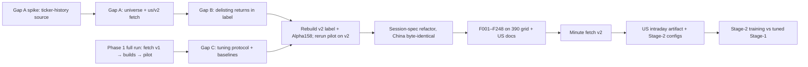

# US Phase 2 Plan: Intraday Features and Open Gaps

This plan covers the US work that remains after Phase 1 (daily Stage 1):

- **Gap A:** survivorship bias
- **Gap B:** delisting returns
- **Gap C:** hyperparameters copied from China
- **Phase 2:** the 390-bar intraday features (Stage 2)

China behavior stays byte-identical throughout. Every item ships with a synthetic-data test and a live smoke run on a small `--symbols` set under an `r2://…/us/smoke/` prefix before any full run.

Status legend: **measured** = verified against live Alpaca/OpenFIGI on 2026-11-17; **[INFERENCE]** = not yet verified.

## Evidence collected

| Finding | Status |
|---|---|
| Alpaca serves complete daily bars for delisted tickers that are **absent from its asset list**: TWTR, ATVI, SIVB, FRC, BBBY, XLNX and CTXS all returned bars up to their delisting dates. Only XLNX appears in the asset list | measured |
| Alpaca's inactive asset list: 2,890 symbols on listed exchanges, 306 of them CUSIP-style placeholders (mostly contras, rights and warrants). OpenFIGI maps 1/40 of those by `ID_CUSIP` | measured |
| OpenFIGI `TICKER` + `includeUnlistedEquities` maps acquired or taken-private names (TWTR, ATVI, XLNX, CTXS) but **not** bankruptcies whose tickers moved to OTC (SIVB, FRC, BBBY) | measured |
| Post-delisting OTC prices (SIVBQ, FRCB, BBBYQ) need a paid Alpaca subscription (`subscription does not permit querying OTC data`) | measured |
| Alpaca's daily `open` vs the official opening auction: median absolute error 0.8 bps, 95th percentile 33 bps, no meaningful bias (see `data_contract.md`) | measured |

So the survivorship gap is a **missing ticker list**, not missing prices. Fixing it needs a historical list of US tickers and a stable identifier for each.

---

## Gap A: Survivorship bias

**Problem.** `fetch_us_daily.py` builds its universe from Alpaca's asset list. That list holds today's securities plus a few inactive ones, so most stocks that were delisted between 2016 and today never enter the universe. Backtests then only see survivors, which inflates IC and top-k returns.

**Plan.**
1. **Spike: pick a free source of historical tickers.**
   - **Need:** for each ticker, the listing and delisting dates and, ideally, a FIGI.
   - **Candidates:**
     - Polygon free tier (`/v3/reference/tickers?active=false`, 5 requests/min): [INFERENCE] has `delisted_utc` and FIGIs.
     - Financial Modeling Prep free tier, delisted-companies endpoint: [INFERENCE].
     - SEC EDGAR Form 25 delisting notices: official, but keyed by CIK, not ticker, so a CIK→ticker mapping would be needed.
   - **Done when:** one source is chosen and the count of delisted US common stocks it reports is recorded.
2. **New table `raw/ticker_history.parquet`.**
   - **Columns:** `ticker, name, share_class_figi, list_date, delist_date, delist_kind`.
   - **Identity:** OpenFIGI `TICKER` + `includeUnlistedEquities`, `exchCode=US`. If that finds nothing (bankrupt tickers reassigned to OTC), fall back to the source's FIGI.
   - **No FIGI:** rows without any FIGI are dropped and counted. Never assign an ID by guessing.
3. **Universe = active assets ∪ ticker history.**
   - Fetch bars by historical ticker with `asof="-"` (no symbol remapping), clipped to `[list_date, delist_date]`, so a reused ticker cannot leak another company's prices.
   - The existing same-FIGI-same-date collision check stays as the safety net.
4. **Manifest counts.** Add `delisted_in_universe`, `delisted_with_bars`, `delisted_unmapped`, and stocks per year.
5. **Validation.**
   - The ever-member count should rise noticeably vs the survivor-only fetch.
   - A backtest on the same config should show IC or top-k returns fall or hold. A rise would indicate a bug.
   - The new data goes under a **new prefix `us/v2`** because R2 outputs are immutable.

**Files:** `us_data/` (new `ticker_history.py`), `scripts/fetch_us_daily.py`, `tests/test_us_data.py`, `docs/data_contract.md`.

---

## Gap B: Delisting returns

**Problem.** The label needs `adj_open[t+6]`. When a stock delists between t+1 and t+6 there is no price, so the anchor is dropped. Collapses like SIVB in March 2023 vanish from the loss and the metrics, while stocks still in membership get rewarded.

**Policy.** This is the standard academic treatment; it needs the delisting dates and kinds from Gap A.

| Delisting kind | Exit price used for the missing endpoint |
|---|---|
| Merger / acquisition (cash or stock) | Last available adjusted price (≈ deal value) |
| Performance (bankruptcy, compliance, liquidation) | Last adjusted price × (1 − δ). Default δ = 30% for NYSE/AMEX and 55% for Nasdaq (Shumway 1997; Shumway & Warther 1999). The δ values are config constants recorded in the label manifest |
| Unknown kind | Treated as performance (conservative) and counted |

**Classification signal** (from the Gap A source, plus a fallback heuristic):
- If the source gives a reason, use it.
- Otherwise use performance when the last close is below $1, or the drawdown over the final 20 sessions exceeds 50%.
- Otherwise use merger.

**Plan.**
1. `build_relative_excess_label` gets an optional `delistings` table `(sec_code, last_trade_date, kind)` plus δ parameters. Without the table, behavior is unchanged, so China stays byte-identical.
2. **Applying the policy.** For anchors where `label_date_t6 > last_trade_date ≥ label_date_t1`:
   - exit price = the policy price;
   - the benchmark endpoint stays SPY at t+6.

   Anchors whose t+1 is already past `last_trade_date` remain dropped.
3. **Manifest:** `delisting_adjusted_count` by kind, plus δ values.
4. **Tests:**
   - a cash-merger stock exits at its last price;
   - a bankruptcy exits at last × (1 − δ);
   - China labels are identical with no delistings table.

**Files:** `labels/relative_excess_return.py`, `scripts/build_relative_excess_label.py` (`--delistings`), `tests/test_relative_excess_label.py`, `docs/data_contract.md`.

---

## Gap C: Hyperparameters

**Problem.** The US configs copy the China settings (MASTER d512, β=10, lr 1e-5, dropout 0.5, MSE, semiannual). US cross-sections are smaller, about 3,000–4,500 stocks after filters [INFERENCE], and the market regime differs.

**Protocol** (no peeking at the test period):
1. **Pilot first.** Run one seed of `master_d512_us_market63`. Record wall time per target and validation rank IC. That timing sets the sweep budget.
2. **Tuning period = 2019–2022 targets only.** Use a separate config with `test_start: 2019-01-01, test_end: 2022-12-31`. The 2023+ test period is evaluated **once**, after choices are frozen.
3. **Sweep.** One seed each, about 18 configs:

   | Knob | Values |
   |---|---|
   | `d_model` | 128, 256, 512 |
   | `beta` | 2, 5, 10 |
   | `learning_rate` | 1e-5, 3e-5, 1e-4 |
   | `loss` | mse, listfold (only on the best two `d_model`) |
   | `dropout` | 0.3, 0.5 (only on the best config) |
4. **Confirm.** Rerun the top two with 3 seeds and pick on mean validation rank IC (ties → smaller model).
5. **Baselines.** Add US configs for the same windows: `lightgbm_us_market63` (needs `uv sync --extra lightgbm`), `gru_us_market63` and `transformer_us_market63`. MASTER should be judged against these, not in isolation.
6. **Rolling frequency.** Compare semiannual and quarterly on the winning config.

**Files:** `configs/us/secondary/*.json` (sweep and tuning configs), `configs/us/stage1/` (baselines and the final choice). Results go under `results/us/` with the same CSV layout as China.

---

## Phase 2: 390-bar intraday features (US Stage 2)

### Session design decisions

| Topic | China (unchanged) | US |
|---|---|---|
| Session | 240 bars: 09:31–11:30, 13:01–15:00 | **390 bars: 09:31–16:00 America/New_York** (bar-end labels; Alpaca timestamps are UTC bar-start, so +1 min then convert to New York) |
| "Morning/afternoon" halves | 120 + 120 around lunch | **195 + 195 split at 12:45 ET.** Keeps the F001–F248 feature names and meanings; there is no lunch jump |
| Lunch-specific logic (`block_returns_cross_lunch`, `one_minute_return_preserves_lunch_jump`) | on | **off.** Block returns run across the whole session |
| Time-of-day windows | open30, midmorning, midafternoon, close30; 60-bar blocks | Same names on the 390 grid; blocks become 30-minute blocks (13) or 6 × 65-bar blocks. Decide during implementation and document it |
| FFT and spectral features | sized to 240 | sized to `bars_per_day`. Frequency-band cutoffs are defined in minutes so the bands mean the same thing |
| Early-close days (13:00 ET, 210 bars, ~3 per year) | n/a | **Marked ineligible (NaN, `source_observed=False`).** The 90% coverage rule would reject them anyway; this makes it explicit |
| Coverage / eligibility | ≥ 90% of 240 bars | ≥ 90% of 390 bars (same rule) |
| Pre-/post-market trades | n/a | Excluded from features |

### Work items

1. **Make the session a parameter, not constants.**
   - `data/minute_session.py`: a `SessionSpec` (bars, clock times, half split, early-close handling) with `CN_SESSION` and `US_SESSION`.
   - `features/intraday/common.py`: replace the hard `240/120/120` check with the spec.
   - `derived/specs.py`: `us_intraday_price_volume_spec()` and `us_intraday_market_spec()` record the session and timezone.
   - **Gate:** China artifacts and the documentation test stay byte-identical, checked against the same hash baseline used for the Alpha158 refactor.
2. **Port F001–F248 to the 390 grid.** Check every module for literal 240/120/60 values or lunch semantics: `time_of_day.py`, `session_shape.py`, `multiscale.py`, `spectral*.py`, `geometry.py` and `event_timing.py`.
   - Same IDs and names; family name **`us_intraday_price_volume`**, so US and China artifacts never mix.
   - **Docs:** `docs/intraday_features_us.md` lists each factor's US window definition. The documentation test is extended to cover it.
3. **Minute fetch.** `scripts/fetch_us_minute.py`:
   - Alpaca SIP 1-minute bars, `adjustment=raw`. Features are within-day ratios, so splits don't matter inside a day.
   - Restricted to Phase 1 ever-members plus SPY/IJH/IJR/IWM.
   - Written as `us/v*/raw/minute/YYYY-MM.parquet` (one object per month, resumable by month).
   - **Volume:** about 4,500 stocks × 2,720 days × 390 bars ≈ 4.8B bars, at most [INFERENCE].

   | Plan | Request rate | Approximate fetch time for ~480k pages (10k bars each) |
   |---|---|---|
   | Free | 200/min | **~40 hours** of request budget, resumable |
   | Algo Trader Plus | 10,000/min | well under a day; bandwidth-bound |

   **Decision for you:** run free over ~2 days, or pay for 1 month of Algo Trader Plus ($99).
4. **Builders.** `build_us_intraday_price_volume_artifact` streams one month of minute data at a time into a disk-backed array, with day-parallel workers at low OS priority (same pattern as the Alpha158 build), float32.
   - Artifact size: about 2,720 × 4,500 × 248 × 4 B ≈ **12 GB** [INFERENCE].
   - Re-check Polars here: minute aggregation is the one workload where it pays off.
5. **Exploratory market state.** `us_intraday_market` uses minute ETF bars for SPY/IJH/IJR/IWM (4 × 48 = 192 features), for the dual-frequency layout.
6. **Layouts and configs.** `FeatureLayout.stage2(market_family=…)` accepts US families. Config layouts `us_stage2_market63` and `us_stage2_market84` go in `configs/us/stage2/`.
7. **Disk budget during Stage-2 training.** Alpha158 (~8 GB) plus intraday (~12 GB) are both materialized: about 20 GB temporary against ~40 GB free. Hold off on the dual-frequency layout until that headroom is confirmed.
8. **Tests.**
   - Synthetic 390-bar sessions: early-close ineligibility, the DST boundary (UTC→New York), the half split at 12:45, and a missing-minute NaN policy.
   - A China byte-identity regression check.
   - A documentation-coverage test for the US catalog.

---

## Optional: exact official open

Alpaca's daily `open` is a close proxy (median 0.8 bps from the auction price). To use the **primary-exchange opening-auction print** exactly:
- **Source:** the first trade with condition `O` on the listing venue between 09:29:55 and 09:40 ET.
- **Venue codes:** `Q` Nasdaq, `N` NYSE, `P` NYSE Arca, `A` NYSE American, `Z` Cboe BZX.
- **Cost:** one multi-symbol trades request per day per symbol batch, about 160k requests ≈ 13 hours on the free tier [INFERENCE].
- **Expected gain:** small. Do it only if Gap C tuning shows label noise matters.

## Sequencing

Gaps A and B come before Phase 2 because they change the universe and the labels that every later experiment depends on. Tuning (Gap C) can start on v1 data to get timings, but the final selection should be rerun on v2.

## Decisions needed from you

1. **Ticker-history source for Gap A:** Polygon free tier, FMP free tier, or SEC EDGAR. Both of the free APIs need you to sign up for a key.
2. **Delisting δ:** keep the Shumway defaults (30% NYSE/AMEX, 55% Nasdaq), or use something else.
3. **Minute fetch:** about 2 days on the free tier, or 1 month of Algo Trader Plus ($99).
4. **Tuning budget:** the number of sweep configs (default about 18 × 1 seed + top 2 × 3 seeds), once the pilot timing is known.
